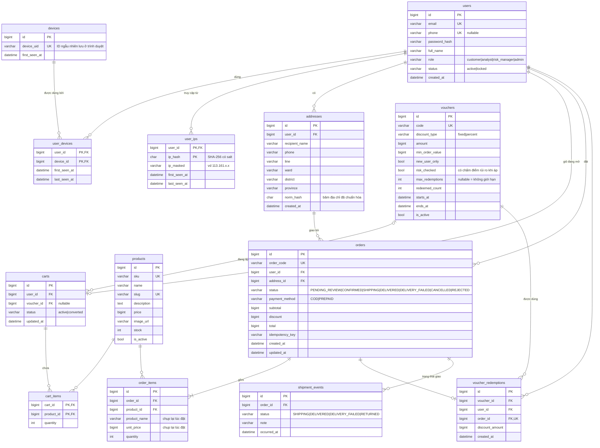

# ERD v1 — Thiết kế cơ sở dữ liệu

> Ngày: 2026-10-30 · Trạng thái: **Bản nháp v1, chờ Luca duyệt**
> CSDL: MariaDB 10.11 (InnoDB, `utf8mb4_unicode_ci`). Quy ước theo skill `db-design`: tiền là `BIGINT` theo đồng, thời gian lưu UTC, mọi bảng có `created_at`.
> Đầu vào: `DEMO_SCRIPT.md` (màn hình, vai trò), `RULES_V0.md` (đặc trưng F01–F11, luật, ma trận quyết định).
> Mức: bảng không đánh dấu là **MVP**; bảng đánh dấu (R) là Recommended.

## 1. Tổng quan theo nhóm

| Nhóm | Bảng | Module sở hữu (chỉ module này được ghi) |
|---|---|---|
| Người dùng và nhận diện | `users`, `devices`, `user_devices`, `user_ips`, `auth_sessions`, `addresses` | auth, events |
| Bán hàng | `products`, `carts`, `cart_items`, `vouchers`, `voucher_redemptions`, `orders`, `order_items`, `shipment_events` | catalog, cart, promotion, order, fulfillment |
| Sự kiện | `events` | events |
| Rủi ro | `rules`, `rule_versions`, `decision_policies`, `risk_decisions`, `rule_hits`, `account_risk_profiles` (R) | rules, risk |
| Xử lý case | `risk_cases`, `case_decisions`, `case_actions`, `appeals` (R) | cases |
| Vận hành | `audit_logs`, `jobs` | audit, worker |
| Thực nghiệm | `sim_runs`, `sim_labels` | simulator |

Tổng: **29 bảng** (27 MVP + 2 Recommended). `account_risk_profiles` chưa vẽ trong sơ đồ vì là Recommended (xem mục 8).

**Bổ sung khi làm module cases (2026-10-30):** bảng `jobs` nằm ở `app/core/jobs.py` (hàng đợi việc nền dùng chung); `case_decisions` thêm `added_at`; `case_actions.staff_id` cho phép NULL (= hệ thống); `audit_logs` thêm `note`; `risk_cases` có index `(status, opened_at)`. Chưa làm bảng `appeals` (Recommended).

**Bổ sung khi làm module order (2026-10-30):** `orders` thêm `payment_status` (UNPAID/PAID) và `voucher_code`; UNIQUE(`user_id`, `idempotency_key`); `order_items` thêm `category` (chụp lại lúc đặt); `addresses` thuộc module order, UNIQUE(`user_id`, `norm_hash`) để không tạo trùng địa chỉ của cùng người; `voucher_redemptions` thuộc module promotion, UNIQUE(`voucher_id`, `user_id`) và UNIQUE(`order_id`); `shipment_events` thêm `actor_id`.

**Bổ sung khi làm module cart + promotion (2026-10-30):** `carts` bỏ cột `status`, thay bằng `UNIQUE(user_id)` (mỗi khách đúng một giỏ, đặt hàng xong thì làm trống); `vouchers` thêm `max_discount` (trần giảm cho loại percent) và `description`; `cart_items` thêm `added_at`. Bảng `voucher_redemptions` sẽ tạo cùng module order (ghi lượt dùng tại thời điểm đặt hàng).

**Bổ sung khi làm module catalog (2026-10-30):** bảng `products` có thêm cột `category` (VARCHAR(32), mã danh mục cố định trong code: audio, computer, home, fashion, sport) và index `(is_active, category)`. Chưa cần bảng `categories` riêng (mục 8).

**Bổ sung khi làm module auth (2026-10-30):** bảng `auth_sessions` (id, `token_hash` CHAR(64) UNIQUE, `user_id` FK, `device_id` FK nullable, `created_at`, `expires_at`, `revoked_at`). Cookie phiên chứa token ngẫu nhiên; CSDL chỉ lưu SHA-256 của token, nên lộ CSDL cũng không dùng lại được phiên. Đăng xuất là ghi `revoked_at`, nên phiên bị thu hồi ngay ở phía server.

## 2. Nhóm người dùng và bán hàng

## 3. Nhóm rủi ro, case và vận hành

```mermaid
erDiagram
  rules ||--|{ rule_versions : "có các phiên bản"
  risk_decisions ||--o{ rule_hits : "giải thích bởi"
  rule_versions ||--o{ rule_hits : "sinh ra"
  decision_policies ||--o{ risk_decisions : "áp dụng"
  risk_decisions |o--o| risk_decisions : "override của"
  risk_cases ||--|{ case_decisions : "gom"
  risk_decisions ||--o{ case_decisions : ""
  risk_cases ||--o{ case_actions : "lịch sử xử lý"
  risk_cases ||--o{ appeals : "khiếu nại (R)"
  sim_runs ||--o{ sim_labels : "nhãn thật"

  rules {
    bigint id PK
    varchar code UK "vd DEV_MULTI_NEW_ACCOUNTS"
    varchar name
    varchar rule_type "count_threshold_tiers|rate_threshold_tiers|compound"
    varchar strength "strong|medium|weak|positive"
    bigint active_version_id FK
    datetime created_at
  }
  rule_versions {
    bigint id PK
    bigint rule_id FK
    int version "UNIQUE(rule_id, version)"
    json contexts
    json params "ngưỡng, bậc, điểm"
    varchar reason_template
    bool enabled
    bigint created_by FK
    varchar change_note
    datetime created_at
  }
  decision_policies {
    bigint id PK
    varchar context "voucher_apply|payment_options|place_order"
    int version
    json thresholds
    bool is_active
    bigint created_by FK
    datetime created_at
  }
  risk_decisions {
    bigint id PK
    char public_id UK "UUID trả cho client"
    varchar context
    bigint user_id FK
    bigint cart_id FK "nullable"
    bigint order_id FK "nullable"
    int score
    varchar decision "ALLOW|ALLOW_WITH_RESTRICTION|REVIEW|BLOCK"
    json actions
    json features_snapshot
    bigint policy_id FK
    decimal latency_ms
    bigint overrides_decision_id FK "nullable"
    bigint decided_by FK "nullable = hệ thống"
    varchar override_reason
    datetime created_at
  }
  rule_hits {
    bigint id PK
    bigint decision_id FK
    bigint rule_version_id FK
    int points
    json observed "giá trị đặc trưng, ngưỡng"
    varchar reason_text
  }
  risk_cases {
    bigint id PK
    varchar case_code UK
    varchar policy "voucher|cod"
    varchar status "OPEN|IN_REVIEW|CONFIRMED_ABUSE|CLEARED|APPEALED"
    varchar cluster_key "vd device:42"
    varchar open_cluster_key UK "= cluster_key khi đang mở, NULL khi đóng"
    bigint primary_user_id FK
    bigint order_id FK "nullable"
    bigint assigned_to FK "nullable"
    varchar outcome_reason
    datetime opened_at
    datetime closed_at
  }
  case_decisions {
    bigint case_id PK,FK
    bigint decision_id PK,FK
  }
  case_actions {
    bigint id PK
    bigint case_id FK
    bigint staff_id FK
    varchar action
    varchar from_status
    varchar to_status
    varchar note "bắt buộc khi kết luận"
    datetime created_at
  }
  appeals {
    bigint id PK
    bigint case_id FK
    bigint user_id FK
    text message
    varchar status "OPEN|ACCEPTED|REJECTED"
    bigint reviewed_by FK
    datetime created_at
  }
  audit_logs {
    bigint id PK
    bigint actor_id FK "nullable = hệ thống"
    varchar action
    varchar entity_type
    varchar entity_id
    json before_data
    json after_data
    varchar request_id
    datetime created_at
  }
  jobs {
    bigint id PK
    varchar job_type
    json payload
    varchar status "queued|running|done|failed"
    int attempts
    int max_attempts
    datetime run_after
    datetime locked_at
    text last_error
    datetime created_at
  }
  events {
    bigint id PK
    varchar event_type "signup|login|product_view|voucher_attempt|checkout_view|order_placed"
    bigint user_id FK "nullable"
    bigint device_id FK "nullable"
    char ip_hash
    varchar session_id
    json payload
    datetime occurred_at
  }
  sim_runs {
    bigint id PK
    varchar scenario
    varchar dataset "dev|test|demo"
    int seed
    json config
    json metrics
    datetime started_at
    datetime finished_at
  }
  sim_labels {
    bigint run_id PK,FK
    bigint user_id PK,FK
    varchar persona
    bool is_abuse
  }
```

## 4. Đặc trưng → bảng → index

Mỗi luật cần đếm nhanh trong một cửa sổ thời gian, nên index được thiết kế **theo đúng câu truy vấn**:

| Đặc trưng | Truy vấn (ý tưởng) | Bảng | Index |
|---|---|---|---|
| F01 tuổi tài khoản | `users.created_at` | users | PK |
| F02 tài khoản mới / thiết bị / 30 ngày | đếm `user_id` trong `user_devices` có `device_id = ?` và `last_seen_at ≥ now − 30d`, JOIN `users` có `created_at ≥ now − 7d` | user_devices, users | `(device_id, last_seen_at)` |
| F03 tài khoản / địa chỉ / 30 ngày | đếm `DISTINCT user_id` trong `addresses` có `norm_hash = ?` và `created_at ≥ now − 30d` | addresses | `(norm_hash, created_at)` |
| F04 tài khoản mới / IP / 24 giờ | như F02, trên `user_ips` | user_ips, users | `(ip_hash, last_seen_at)` |
| F05 lần thử voucher / thiết bị / 10 phút | đếm `events` loại `voucher_attempt` theo `device_id` | events | `(device_id, event_type, occurred_at)` |
| F06 đăng ký → đặt hàng, lượt xem sản phẩm | `events` theo `user_id` / `session_id` | events | `(user_id, event_type, occurred_at)` |
| F07, F08 đơn COD đã kết thúc, thất bại | đếm `orders` có `payment_method = COD` và `status IN (DELIVERED, DELIVERY_FAILED)` của user | orders | `(user_id, payment_method, status)` |
| F09 đơn giao thành công | đếm `orders` có `status = DELIVERED` | orders | như trên |
| F10 đơn COD đang chờ | đếm `orders` COD có `status IN (PENDING_REVIEW, CONFIRMED, SHIPPING)` | orders | như trên |
| F11 giá trị đơn | tính từ giỏ hàng tại thời điểm đánh giá | carts, cart_items | PK |

**Thời điểm đánh giá:** F07–F10 chỉ tính đơn có kết quả **trước** thời điểm đánh giá. Khi chạy mô phỏng có "đồng hồ giả", mọi truy vấn dùng `as_of` thay cho `now()`.

## 5. Ràng buộc quan trọng (hàng rào ở tầng CSDL)

| Ràng buộc | Chống chuyện gì |
|---|---|
| `UNIQUE(voucher_redemptions.voucher_id, user_id)` | Một tài khoản dùng một voucher hai lần (kể cả hai request đồng thời) |
| `UPDATE vouchers SET redeemed_count = redeemed_count + 1 WHERE id = ? AND (max_redemptions IS NULL OR redeemed_count < max_redemptions)` rồi kiểm tra số dòng bị ảnh hưởng | Voucher bị dùng quá tổng số lượt khi nhiều người giành cùng lúc |
| `UNIQUE(orders.user_id, idempotency_key)` | Bấm đặt hàng 2 lần, hoặc mạng gửi lại request, tạo ra 2 đơn |
| `UNIQUE(risk_cases.open_cluster_key)` | Hai case đang mở cho cùng một cụm. MariaDB không có partial unique index, nên dùng cột chỉ có giá trị khi case mở và `NULL` khi đóng (UNIQUE cho phép nhiều NULL) |
| `UNIQUE(rule_versions.rule_id, version)` | Trùng số phiên bản luật |
| `risk_decisions`, `rule_hits`, `audit_logs`, `events`, `case_actions`, `shipment_events`: **chỉ ghi thêm** | Sửa hoặc xóa dấu vết. Override tạo quyết định mới trỏ về quyết định cũ |
| `jobs`: lấy việc bằng `SELECT ... FOR UPDATE SKIP LOCKED` | Hai worker cùng xử lý một job (MariaDB hỗ trợ từ 10.6) |

## 6. Dữ liệu cá nhân

| Dữ liệu | Lưu thế nào | Ai được xem |
|---|---|---|
| IP | `ip_hash` (SHA-256 có salt, để đếm) + `ip_masked` (để hiển thị). **Không lưu IP gốc** | Analyst thấy bản che |
| Địa chỉ | Đầy đủ (cần để giao hàng) + `norm_hash` để so khớp | Analyst thấy phường/quận/tỉnh; địa chỉ chi tiết chỉ Admin |
| Email | Đầy đủ (dùng để đăng nhập) | Mọi API Console trả bản che (`mi***@gmail.com`), che ở backend (`app/core/privacy.py`). Bản đầy đủ: Risk Manager/Admin bấm "Xem liên hệ", bắt buộc ghi lý do, ghi audit `user.reveal_contact` |
| Số điện thoại | Đầy đủ | Console không hiển thị; chỉ trả qua "Xem liên hệ" (có lý do + audit) |
| Lần thử đăng nhập (`login_attempts`) | Chỉ `email_hash` và `ip_hash` (HMAC), không lưu email/IP gốc | Không hiển thị; chỉ dùng để đếm số lần sai |
| Mật khẩu | Băm (bcrypt hoặc argon2) | Không ai |
| `device_uid` | ID ngẫu nhiên, **không phải fingerprint thật** | Analyst |

## 7. Tách dữ liệu thực nghiệm

- `sim_labels` chứa **nhãn thật** (persona nào là kẻ gian). **Module `risk` không bao giờ đọc bảng này.** Chỉ script đánh giá đọc nó, để so với quyết định của hệ thống. Đây là cách chống "gian lận" khi đánh giá.
- `sim_runs.dataset` phân biệt `dev`, `test`, `demo`; seed và cấu hình được lưu lại để chạy lại ra đúng kết quả.

## 8. Quyết định thiết kế cần Luca biết

1. **Một bảng `users` cho cả khách lẫn nhân viên**, phân biệt bằng `role`. Đơn giản hơn hai bảng riêng. Đánh đổi: phải kiểm tra vai trò thật chặt ở mọi endpoint Console.
2. **Không có bảng `account_risk_profiles` trong MVP:** F07–F10 tính trực tiếp từ `orders` (nhanh nhờ index). Bảng hồ sơ là Recommended, để worker cập nhật bất đồng bộ khi dữ liệu lớn.
3. **Không lưu điểm "Trust Score" cố định cho từng tài khoản.** Điểm được tính lại cho từng hành động và lưu trong `risk_decisions`. Đây là thay đổi so với đề cương.
4. **Bảng `categories` chưa có:** demo không cần danh mục sản phẩm. Thêm sau nếu muốn trang chủ đẹp hơn.

## 9. Việc tiếp theo
- Luca duyệt ERD.
- Viết từ điển dữ liệu chi tiết khi tạo migration (skill `db-design`).
- Tạo khung dự án `backend/` và `frontend/`, rồi migration đầu tiên.
