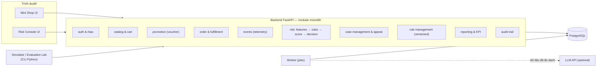
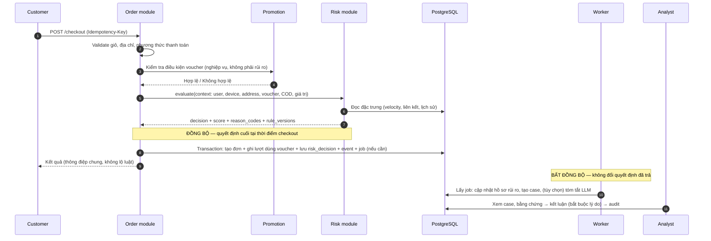
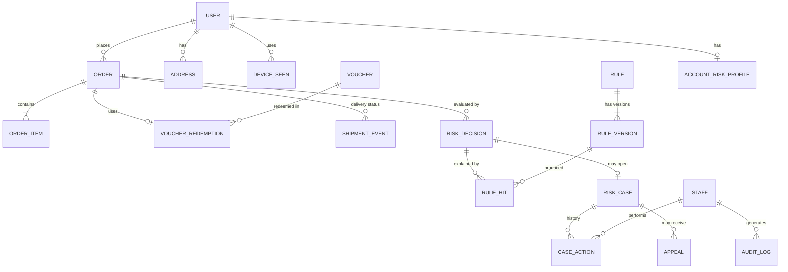
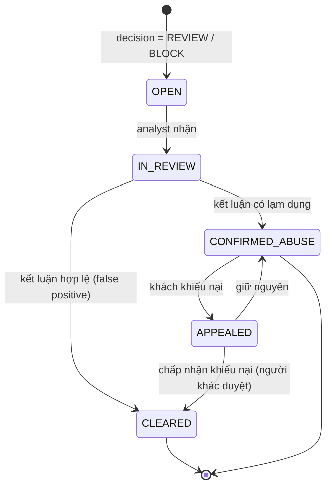

# INITIAL PROJECT REVIEW — Đánh giá và tư vấn đồ án tốt nghiệp

> Ngày: 2026-10-30 · Đầu vào: `DeCuong_DATN_HaTienLuc_2251162067_64HTTT4.docx` (bản tóm tắt đề cương, GVHD ThS. Tạ Chí Hiếu)
> Tính chất: **tư vấn và phản biện — chưa phải quyết định đã chốt.** Mọi quyết định sẽ chỉ ghi vào `DECISIONS.md` sau khi Luca đồng ý.

**Quy ước nguồn trong tài liệu này**

| Ký hiệu | Ý nghĩa |
|---|---|
| **[ĐC]** | Lấy trực tiếp từ đề cương của Luca |
| **[KT]** | Kiến thức kỹ thuật đã được biết đến rộng rãi |
| **[ĐX]** | Đề xuất / suy luận của cố vấn |
| **[XM]** | Cần nghiên cứu hoặc xác minh thêm |

---

## Tóm tắt điều hành (đọc phần này trước)

1. **Bài toán đúng và có giá trị thực tế**, nhưng đề cương đang ôm **4 loại lạm dụng + 6 thành phần công nghệ + LLM** trong 15 tuần. Đây là rủi ro lớn nhất khiến đồ án không hoàn thành.
2. **Công thức Trust Score có lỗi thiết kế cốt lõi:** tài khoản mới không có lịch sử → không bị phạt → T = 100 → "An toàn". Trong khi đó hành vi gom voucher bằng tài khoản mới lại chính là thứ cần bắt.
3. **Ba chỉ tiêu p95 ≤ 45 ms, FPR ≤ 5% và 16 biến thể chưa có cơ sở đo đúng.** Với 4 biến thể hợp lệ, mỗi ca chặn nhầm làm FPR nhảy 25%. 45 ms thì quá dễ đạt trên máy local nên không chứng minh được gì.
4. **MongoDB không phù hợp bằng PostgreSQL** cho dữ liệu đơn hàng/voucher/case có quan hệ chặt và cần transaction. **Celery nặng hơn mức cần.** **LLM nên là phần tùy chọn**, không nằm trong lõi.
5. **Khuyến nghị:** giữ vấn đề cốt lõi nhưng thu hẹp còn **2 nhóm chính sách (voucher người mới + COD)**. Xây theo hướng **"Risk Decision Platform + sàn mô phỏng tối giản + phòng thí nghiệm mô phỏng/đánh giá"** trong một **modular monolith** (một ứng dụng duy nhất, chia module rõ ràng).

---

# PHẦN 1 — PHÂN TÍCH VÀ PHẢN BIỆN ĐỀ CƯƠNG

## 1.1. Tóm tắt đề cương [ĐC]

| Hạng mục | Nội dung trong đề cương |
|---|---|
| **Bài toán** | Lạm dụng chính sách (tài khoản ảo gom voucher, gian lận cước vận chuyển, bùng hàng COD) gây tổn thất và sai lệch chỉ số; kiểm soát thủ công chậm, không theo kịp quy mô |
| **Mục tiêu hệ thống** | Web TMĐT rút gọn (React, FastAPI, MongoDB) có duyệt hàng, giỏ hàng, mã khuyến mãi, thanh toán sandbox mô phỏng |
| **Mục tiêu rủi ro** | Trust Score bằng công thức; luồng đồng bộ (Rule + thống kê tần suất bằng Redis, p95 ≤ 45 ms độ trễ bổ sung) và luồng bất đồng bộ (Celery/Redis → AI tóm tắt, giải trình) |
| **Mô hình** | T(u,t) = max(0, 100 − Σ wᵢ·Pᵢ(u,t) + B(u,t)); w = 35 (thiết bị/IP), 25 (vận tốc đặt đơn), 25 (tỷ lệ bùng hàng), 15 (bất thường giỏ hàng); bán rã 14 ngày; ngưỡng ≥70 an toàn, 40–70 gắn cờ (hạn chế voucher, đẩy AI), <40 chặn (không tạo link thanh toán) |
| **Người dùng** | Khách hàng mua sắm; quản trị viên (Fraud Dashboard, Admin Override). Chưa tách vai trò chi tiết |
| **Chức năng chính** | Quản lý người dùng/sản phẩm/giỏ/voucher; Telemetry (IP, fingerprint); Risk Engine 2 tầng; hàng đợi AI; Dashboard hiển thị mã vi phạm, lý do từ AI, ghi đè quyết định |
| **Kiểm thử** | 4 kịch bản trục lợi × 3 biến thể = 12, cộng 4 biến thể hợp lệ dễ nhầm = 16; đo số ca thử/chặn/lọt/chặn nhầm; FPR ≤ 5%; đối chiếu 100% Dashboard–log; mở rộng: Precision/Recall/F1 và đường cong tối ưu ngưỡng |
| **Kế hoạch** | T1–3 thiết kế; T4–7 xây dựng; T8–10 đo đạc; T11–13 dữ liệu lớn + LLM + tối ưu ngưỡng; T14–15 báo cáo |
| **Tài liệu tham khảo** | 2 tài liệu (VECOM EBI 2023; một tài liệu về phát hiện bất thường luồng mạng) |

## 1.2. Chấm điểm tham khảo

> **Giới hạn của việc chấm điểm:** đây là đánh giá chủ quan của cố vấn [ĐX], dựa trên **bản tóm tắt 2 trang**, không phải thang điểm của Khoa. Điểm chỉ dùng để thấy chỗ nào yếu nhất mà ưu tiên sửa, không dự đoán điểm bảo vệ.

| # | Tiêu chí | Điểm | Căn cứ |
|---|---|---|---|
| 1 | Tính thực tiễn | **8** | Gom voucher, bùng hàng COD là vấn đề có thật ở TMĐT Việt Nam. Nhưng đề cương chưa có số liệu dẫn chứng mức thiệt hại |
| 2 | Phù hợp ngành HTTT quản lý | **7** | Có yếu tố hỗ trợ ra quyết định và giám sát. Còn thiếu quy trình nghiệp vụ, vai trò, KPI quản trị — những thứ hội đồng MIS sẽ tìm |
| 3 | Giá trị học thuật | **6** | Có ý định hình thức hóa và đo lường định lượng (tốt). Nhưng trọng số, ngưỡng, chu kỳ bán rã đều chưa có cơ sở; cách đánh giá có nguy cơ vòng lặp (tự viết luật, tự viết test) |
| 4 | Tính mới / khác biệt | **5** | Rule + điểm số + LLM tóm tắt là cách làm phổ biến. Điểm khác biệt có thể xây dựng: quyết định theo từng chính sách, có hard negatives và phòng thí nghiệm đánh giá |
| 5 | Khả năng áp dụng thực tế | **5** | Risk Engine gắn chặt vào sàn tự xây, chưa có hợp đồng tích hợp (API) để sàn khác dùng |
| 6 | Khả thi với một sinh viên | **4** | 4 loại lạm dụng (cả phía người mua, người bán, vận chuyển) + React/FastAPI/Mongo/Redis/Celery/LLM + fingerprint, trong 15 tuần, với người chưa có kinh nghiệm dự án thật |
| 7 | Hoàn chỉnh nghiệp vụ | **4** | Thiếu vòng đời đơn hàng/giao hàng (cần để biết "bùng hàng"), vòng đời case, khiếu nại, quản lý luật, phân quyền, cấu hình chính sách |
| 8 | Kiến trúc và công nghệ | **5** | Ý tưởng tách đồng bộ/bất đồng bộ là đúng. Nhưng chọn MongoDB chưa hợp lý, Celery nặng, và vùng 40–70 "đẩy sang AI" mâu thuẫn với quyết định đồng bộ |
| 9 | Khả năng kiểm chứng | **5** | Có hard negatives (rất tốt). Nhưng mẫu quá nhỏ, chỉ số chưa định nghĩa, chưa tách tập tinh chỉnh và tập kiểm thử |
| 10 | Khả năng bảo vệ | **6** | Tiềm năng demo tốt. Dễ bị hỏi vặn ở trọng số, con số 45 ms, FPR và LLM |

## 1.3. Điểm mạnh nên giữ

- **Tách luồng đồng bộ (fast-path) và bất đồng bộ (audit-path).** Đây là đúng tư duy hệ thống chống gian lận: quyết định nhanh tại thời điểm giao dịch, phân tích sâu sau đó.
- **Có kịch bản hard negatives** (ca hợp lệ nhưng dễ bị nhầm). Rất nhiều đồ án bỏ qua chỗ này. Đây là điểm cộng lớn về tư duy false positive.
- **Có ý định đo định lượng** (ca chặn, ca lọt, ca chặn nhầm) và **đối chiếu Dashboard–log** (tư duy audit).
- **Có Admin Override**, tức là con người được quyền quyết định cuối.
- **Đề cập fingerprint/IP nhưng dùng làm tín hiệu phạt, không phải chặn tuyệt đối.** Hướng đúng, chỉ cần nói rõ hơn.

## 1.4. Điểm yếu nên khắc phục

| Điểm yếu | Vì sao là vấn đề | Rủi ro nếu giữ nguyên |
|---|---|---|
| Phạm vi 4 loại lạm dụng trải rộng nhiều phía | "Bơm đơn ảo" là gian lận **phía người bán** (brushing), "trục lợi cước" cần mô phỏng **chính sách trợ giá vận chuyển và địa lý**, COD cần **vòng đời giao hàng**. Mỗi loại kéo theo một mảng nghiệp vụ riêng | Làm loại nào cũng nông; không kịp tiến độ |
| Trust Score một tầng theo tài khoản | Không thấy được rủi ro **của từng giao dịch**; tài khoản mới mặc định 100 điểm | Bỏ lọt đúng hành vi cần bắt (xem Phần 6) |
| LLM nằm trong phạm vi chính | Khó đánh giá chất lượng, có chi phí, có rủi ro gửi dữ liệu cá nhân ra ngoài, có thể "bịa" lý do | Tốn thời gian ở phần ít giá trị chấm điểm nhất |
| Thiếu quy trình nghiệp vụ | Đề tài HTTT quản lý cần trả lời: ai xử lý case, trong bao lâu, khiếu nại thế nào, ai được sửa luật | Hội đồng đánh giá là "đồ án kỹ thuật" thiếu chất MIS |
| Tài liệu tham khảo rất mỏng | Chỉ 2 tài liệu; tài liệu [2] về phát hiện bất thường **luồng mạng**, không phải TMĐT. Tên cơ quan tác giả và đơn vị xuất bản không khớp nhau [XM] | Phần cơ sở lý thuyết yếu; có thể bị hỏi về nguồn |

## 1.5. Những giả định thiếu căn cứ

1. **Trọng số 35/25/25/15 và ngưỡng 40/70** — không nêu nguồn gốc. Nếu hội đồng hỏi "vì sao 35 mà không phải 30?", hiện chưa có câu trả lời.
2. **Chu kỳ bán rã 14 ngày** — vì sao 14? Áp cho thành phần nào? Áp cho cả lịch sử bùng hàng thì sau khoảng 1–2 tháng kẻ bùng hàng lại "sạch".
3. **Fingerprint và IP đủ tin cậy để chiếm trọng số lớn nhất (35)** — thực tế đây là các tín hiệu **yếu và nhiễu** (xem 6.5).
4. **"Hệ thống hoạt động mượt mà"** — không đo được, không nên đưa vào kết quả dự kiến.
5. **LLM "phân tích ngữ cảnh hành vi"** — chưa nói LLM nhận dữ liệu gì, trả ra gì, và kết quả được dùng để làm gì.
6. **"Bảng kiểm tra chéo 100% khớp"** — có thể đạt được, nhưng chỉ có ý nghĩa nếu định nghĩa rõ "khớp" là khớp trường nào và kiểm bằng script tự động.

## 1.6. Thành phần phức tạp không cần thiết (ở mức MVP)

| Thành phần | Nhận định |
|---|---|
| Celery | Chỉ có 1–2 loại tác vụ nền; Celery có nhiều khái niệm (broker, backend, routing, beat) vượt nhu cầu |
| Redis cho thống kê tần suất | Ở quy mô đồ án, truy vấn SQL có index đủ nhanh. Redis có thể là **thí nghiệm so sánh**, không bắt buộc ngay |
| LLM API | Giải thích dựa trên **mã lý do (reason code) + template** đã đủ cho MVP và chính xác 100% so với luật |
| Fingerprint thật trên trình duyệt | Trong thực nghiệm, `device_id` là trường mô phỏng; tích hợp thư viện fingerprint thật chỉ phục vụ demo |
| "Khoảng cách địa lý ảo" | Cần dữ liệu địa lý và mô hình phí ship. Nên bỏ khỏi MVP |

## 1.7. Chức năng quan trọng còn thiếu

- **Vòng đời đơn hàng và giao hàng** (đã giao / giao thất bại / hoàn). Đây là **nguồn nhãn** để biết ai bùng hàng.
- **Quản lý chính sách voucher** (điều kiện, giới hạn lượt, đối tượng) và **ràng buộc chống dùng trùng** ở mức cơ sở dữ liệu.
- **Case Management** (hàng đợi, phân công, trạng thái, kết luận).
- **Quy trình khiếu nại (appeal)** cho khách bị hạn chế hoặc chặn.
- **Hành động trung gian** ngoài cho phép/chặn: bỏ voucher, tắt COD và yêu cầu trả trước, yêu cầu xác minh (OTP), giữ đơn chờ duyệt.
- **Quản lý luật có phiên bản** và lưu lại "luật nào, phiên bản nào, đã ra quyết định gì".
- **RBAC** (Role-Based Access Control — phân quyền theo vai trò) và **Audit Trail** (nhật ký kiểm toán) không sửa được.
- **Bảo vệ dữ liệu cá nhân:** tối thiểu hóa dữ liệu, che (mask) IP/SĐT trên dashboard, thời hạn lưu trữ.

## 1.8. Nguy cơ khiến đồ án không hoàn thành

| Nguy cơ | Mức | Dấu hiệu sớm |
|---|---|---|
| Phạm vi quá rộng | Cao | Hết tuần 6 chưa chạy được luồng checkout đầu-cuối |
| Học quá nhiều công nghệ cùng lúc | Cao | Tuần 3–4 vẫn đang "cài đặt môi trường" |
| Dành thời gian cho giao diện mua sắm | Trung bình | Giao diện shop đẹp nhưng Risk Engine chưa có |
| Dữ liệu mô phỏng không thuyết phục | Cao | Kết quả 100% chính xác (dấu hiệu dữ liệu quá dễ) |
| Phụ thuộc LLM API | Trung bình | Hết hạn mức, lỗi mạng khi demo |
| Không có thời gian viết báo cáo | Cao | Đến tuần 13 mới bắt đầu viết |

## 1.9. Câu hỏi hội đồng có khả năng chất vấn

1. Trọng số 35/25/25/15 lấy từ đâu? Nếu đổi thành 30/30/20/20 thì kết quả thay đổi thế nào?
2. Dữ liệu là mô phỏng. Làm sao chứng minh kết quả có ý nghĩa với dữ liệu thật?
3. Em tự viết luật và tự viết kịch bản kiểm thử, vậy có phải luật "học thuộc" bài kiểm tra không?
4. FPR 5% được tính trên bao nhiêu giao dịch hợp lệ?
5. 45 ms đo ở đâu, trên máy nào, với bao nhiêu người dùng đồng thời?
6. Cả gia đình dùng chung Wi-Fi thì có bị chặn không? Người dùng mạng di động (nhiều người chung một IP) thì sao?
7. LLM có quyết định chặn không? Nếu LLM giải thích sai thì ai chịu trách nhiệm?
8. Gửi dữ liệu khách hàng cho LLM bên ngoài có vi phạm quy định bảo vệ dữ liệu cá nhân không?
9. Khách bị chặn nhầm thì khiếu nại ở đâu, ai xử lý?
10. Admin có thể lạm dụng quyền override không? Ai giám sát admin?
11. Vì sao dùng MongoDB cho dữ liệu đơn hàng có quan hệ chặt?
12. Kẻ gian biết luật thì có lách được không?
13. Hệ thống này khác gì so với việc chỉ đặt giới hạn "mỗi số điện thoại một voucher"?

## 1.10. Kiểm tra bốn chỉ tiêu định lượng

### a) p95 ≤ 45 ms (độ trễ bổ sung tại checkout)

- **[KT]** p95 nghĩa là 95% yêu cầu nhanh hơn ngưỡng này. Đo độ trễ theo phân vị là cách làm đúng, vì giá trị trung bình che mất các yêu cầu chậm (xem Dean & Barroso, 2013).
- **Vấn đề:**
  - Chưa định nghĩa đo từ đâu đến đâu, trên phần cứng nào, với tải bao nhiêu (số yêu cầu mỗi giây, số người dùng đồng thời).
  - "Độ trễ bổ sung" phải là hiệu số giữa *có Risk Engine* và *không có Risk Engine* trong cùng điều kiện.
  - **[ĐX]** Trên một máy local, vài truy vấn có index cộng vài phép tính luật thường chỉ tốn vài mili-giây, nên 45 ms gần như chắc chắn đạt. Nó không chứng minh được thiết kế tốt. Đây là **suy luận, chưa đo**.
  - Con số 45 không có nguồn gốc (vì sao không phải 50 hay 100?).
- **Khuyến nghị:**
  - Đổi thành **"ngân sách độ trễ" (latency budget) là mục tiêu thiết kế**, ví dụ "đánh giá rủi ro ≤ 50 ms tại p95 ở mức tải X".
  - Báo cáo **p50/p95/p99 ở 2–3 mức tải** và mô tả môi trường đo.
  - Thêm một thí nghiệm có giá trị hơn: **so sánh hai cách tính đặc trưng (SQL so với Redis)**, hoặc **đo khi tải tăng dần để tìm điểm gãy**.

### b) FPR ≤ 5%

- **[KT]** FPR (False Positive Rate — tỷ lệ chặn nhầm) = FP / (FP + TN), tính trên **tất cả giao dịch hợp lệ**.
- **Vấn đề:**
  - Nếu chỉ có 4 biến thể × 1 lần chạy = 4 ca hợp lệ, mỗi ca chặn nhầm làm FPR tăng **25%**, nên mục tiêu 5% vô nghĩa về thống kê.
  - Nếu chỉ tính trên hard negatives thì FPR bị **thổi phồng**; nếu chỉ tính trên giao dịch bình thường thì bị **làm đẹp**.
  - **Vòng lặp:** người thiết kế luật cũng là người thiết kế kịch bản và tinh chỉnh tới khi đạt 5%. Hội đồng sẽ coi đó là "học thuộc bài".
- **Khuyến nghị:**
  - Sinh **hàng trăm đến hàng nghìn phiên bản** cho mỗi biến thể, có tham số ngẫu nhiên (giờ đặt, giá trị giỏ, số thành viên gia đình…).
  - Báo cáo FPR **tách riêng** cho giao dịch thường và hard negatives, kèm **khoảng tin cậy** (ví dụ Wilson interval).
  - **Khóa tập kiểm thử** (seed khác, tham số khác) trước khi tinh chỉnh.
  - Đặt 5% là **mục tiêu dự kiến**, không cam kết.

### c) Bộ 16 biến thể

- Cấu trúc 4 × 3 + 4 là khung tốt để **thiết kế kịch bản**, nhưng **không phải cỡ mẫu**. Biến thể là "loại tình huống"; mỗi loại cần nhiều mẫu.
- Một số biến thể có vấn đề:
  - **"Lịch sử bùng hàng ≥ 70%"** là luật trùng với chính kịch bản, tức tự kiểm tra chính mình.
  - **"Trùng thông tin nhận tiền"** thuộc phía người bán.
  - **"Khoảng cách địa lý ảo"** chưa định nghĩa.
  - **"Đặt đêm hủy ngay"** chưa rõ thiệt hại là gì nếu đơn bị hủy trước khi giao.
- Nên thêm các **ca chưa biết (unseen variants)**: biến thể mà luật không được thiết kế riêng cho nó, để đo khả năng tổng quát hóa.

### d) Công thức Trust Score

Phân tích chi tiết ở **Phần 6**. Tóm tắt các lỗi:

- Pᵢ chưa định nghĩa miền giá trị (0–1? nhị phân?).
- B(u,t) chưa định nghĩa; không có chặn trên nên T có thể vượt 100.
- Lỗi khởi đầu lạnh (cold start): tài khoản mới mặc định 100 điểm.
- Trộn uy tín dài hạn với tín hiệu tức thời (vận tốc, giỏ hàng).
- Không gắn với ngữ cảnh chính sách (voucher hay COD).

---

# PHẦN 2 — ĐỊNH HƯỚNG SẢN PHẨM

## 2.1. So sánh các hướng

| Tiêu chí | **A.** Web TMĐT rút gọn tích hợp chống gian lận | **B.** Nền tảng quản trị rủi ro độc lập + TMĐT mô phỏng | **C.** Lai: TMĐT demo + Risk Dashboard + API tích hợp |
|---|---|---|---|
| Giá trị nghiệp vụ | Trung bình — giải pháp gắn chặt một sàn | Cao — giống cách doanh nghiệp mua hoặc xây hệ thống risk | Cao |
| Phù hợp đồ án MIS | Trung bình | Cao (quy trình, vai trò, KPI) | Cao |
| Điểm nổi bật khi demo | Mua hàng → bị chặn | Dashboard, case, luật, báo cáo; ít "cảm giác thật" nếu không có shop | Cả hai: mua hàng thật trên UI → case xuất hiện → analyst xử lý |
| Độ khó lập trình | Trung bình, nhưng dễ sa vào làm shop | Trung bình–cao | Cao nhất nếu làm shop đầy đủ |
| Phạm vi / thời gian | Rủi ro dồn công sức vào shop | Vừa phải | Dễ vượt phạm vi |
| Tiềm năng thực tế | Thấp | Cao | Cao |
| Rủi ro chính | Đồ án thành "web bán hàng có vài if-else" | Thiếu nguồn sự kiện thực tế | Làm hai sản phẩm cùng lúc |

## 2.2. Khuyến nghị: hướng **D — "Risk Decision Platform" có sàn mô phỏng tối giản và phòng thí nghiệm đánh giá** [ĐX]

Về bản chất đây là hướng C, nhưng **dời trọng tâm sang B** và thêm một thành phần mà cả ba hướng đều thiếu:

```
┌─────────────────────────────────────────────────────────────┐
│ 1. Mini Shop (tối giản)   → nguồn sự kiện + demo trực quan  │
│ 2. Risk Decision Module   → API: sự kiện vào → quyết định ra│  ← lõi đồ án
│ 3. Risk Console           → case, luật, báo cáo, audit      │  ← lõi MIS
│ 4. Simulation & Evaluation Lab → sinh dữ liệu, chạy, đo     │  ← lõi học thuật
└─────────────────────────────────────────────────────────────┘
```

**Vì sao chọn hướng này:**

1. **Nguồn dữ liệu thực sự của đồ án là bộ mô phỏng, không phải giao diện shop.** Giao diện shop chỉ cần đủ để demo một luồng mua hàng trực quan. Khoảng 80% số liệu thực nghiệm đến từ Simulator gọi cùng API.
2. **Risk Decision Module có hợp đồng API rõ ràng** (nhận sự kiện, trả quyết định kèm lý do). Nhờ vậy em trả lời được câu "áp dụng cho sàn khác thế nào" mà không cần tách microservice.
3. **Risk Console là nơi thể hiện chất MIS:** quy trình xử lý, phân quyền, KPI, khiếu nại.
4. **Evaluation Lab biến "kiểm thử" thành "thực nghiệm khoa học":** có tập tinh chỉnh, tập kiểm thử, phát lại dữ liệu (replay) và so sánh phiên bản luật.

**Điều cần tránh:** làm shop có đăng nhập mạng xã hội, đánh giá sản phẩm, tìm kiếm nâng cao, cổng thanh toán thật… Không phần nào trong đó được chấm điểm.

## 2.3. Đề xuất thu hẹp phạm vi chính sách

| Nhóm lạm dụng | Đề xuất | Lý do |
|---|---|---|
| **Gom voucher bằng nhiều tài khoản** (voucher tân thủ, mã giới hạn lượt) | **MVP** | Phổ biến, dễ mô phỏng, có hard negative rõ (gia đình chung Wi-Fi, người mới hợp lệ) |
| **Bùng hàng COD** | **MVP** | Đặc thù Việt Nam, có thiệt hại cụ thể (phí giao hàng, hoàn hàng), có hành động trung gian hay (tắt COD, yêu cầu trả trước) |
| Trục lợi trợ giá vận chuyển | Recommended (nếu kịp) | Cần mô hình phí ship, phức tạp hơn |
| Bơm đơn ảo phía người bán | **Ngoài phạm vi** — đưa vào hướng phát triển | Cần mô hình người bán, xếp hạng, thanh toán cho người bán; là một đề tài riêng |

**Tên đề tài** có thể giữ nguyên. Nếu GVHD đồng ý, có thể làm rõ hơn [ĐX]:
> *"Xây dựng hệ thống kiểm soát rủi ro và ngăn ngừa lạm dụng chính sách khuyến mãi và thanh toán khi nhận hàng (COD) trên sàn thương mại điện tử"*

Tên này hẹp hơn nhưng dễ bảo vệ hơn. **Cần hỏi ý kiến GVHD trước khi đổi.**

---

# PHẦN 3 — HỆ THỐNG CHỨC NĂNG

## 3.1. Vai trò người dùng [ĐX]

| Vai trò | Ai trong thực tế | Mục tiêu chính |
|---|---|---|
| **Customer** | Người mua | Mua hàng thuận lợi, không bị chặn nhầm, khiếu nại được |
| **Marketplace Admin** | Vận hành sàn | Quản lý sản phẩm, voucher, chính sách COD |
| **Fraud Analyst** | Nhân viên kiểm soát rủi ro | Xử lý case nhanh, chính xác, có bằng chứng |
| **Risk Manager** | Trưởng nhóm rủi ro | Quản lý luật và ngưỡng, xem hiệu quả, duyệt thay đổi luật |
| **System Admin** | Quản trị kỹ thuật | Tài khoản nội bộ, phân quyền, xem audit |

> **Gộp vai trò cho MVP:** có thể gộp Marketplace Admin vào Risk Manager. Nhưng **giữ riêng Analyst và Manager** để thể hiện **phân tách nhiệm vụ** (Segregation of Duties): người xử lý case không tự sửa luật.

## 3.2. Danh sách chức năng theo phân hệ

### Phân hệ 1 — Mini Shop (phía khách hàng)

| Chức năng | Mức | Nghiệp vụ thực tế |
|---|---|---|
| Đăng ký, đăng nhập | MVP | Tài khoản mới là tín hiệu rủi ro quan trọng (tuổi tài khoản) |
| Danh sách và chi tiết sản phẩm (tối giản) | MVP | Chỉ để tạo giỏ hàng |
| Giỏ hàng, áp voucher | MVP | **Điểm kiểm soát #1:** đánh giá rủi ro khi áp voucher |
| Địa chỉ nhận hàng | MVP | Địa chỉ trùng giữa nhiều tài khoản là tín hiệu liên kết |
| Checkout với COD hoặc trả trước (sandbox giả lập) | MVP | **Điểm kiểm soát #2:** đánh giá rủi ro khi đặt đơn |
| Màn hình nhận kết quả (bị bỏ voucher, chuyển sang trả trước, chờ xác minh) | MVP | Thông báo **chung chung**, không lộ luật |
| Lịch sử đơn hàng | Recommended | |
| Gửi khiếu nại về quyết định | Recommended | Quy trình xem xét lại |
| Xác minh OTP giả lập | Advanced | Hành động "challenge" |

### Phân hệ 2 — Quản trị sàn (Marketplace Admin)

| Chức năng | Mức | Nghiệp vụ |
|---|---|---|
| Quản lý voucher: điều kiện, giới hạn lượt, đối tượng (tân thủ), thời hạn | MVP | Chính sách là thứ bị lạm dụng, nên phải mô hình hóa rõ |
| Giả lập trạng thái giao hàng (đã giao / giao thất bại / hoàn) | MVP | **Nguồn nhãn** để biết ai bùng hàng; thay cho đơn vị vận chuyển thật |
| Quản lý sản phẩm (CRUD tối giản hoặc seed sẵn) | MVP (seed) | Không phải trọng tâm |
| Cấu hình chính sách COD (giá trị tối đa, điều kiện) | Recommended | |

### Phân hệ 3 — Risk Decision Engine (không có giao diện, là lõi)

| Chức năng | Mức | Nghiệp vụ |
|---|---|---|
| Ghi nhận sự kiện (đăng ký, đăng nhập, áp voucher, checkout, giao hàng) | MVP | Telemetry; là nguồn đặc trưng (feature) |
| Tính đặc trưng (velocity, số tài khoản trên cùng thiết bị/địa chỉ, tỷ lệ giao thất bại…) | MVP | |
| Đánh giá luật đã cấu hình → điểm + danh sách luật khớp + mã lý do | MVP | Có thể giải thích được |
| Ma trận quyết định theo ngữ cảnh (voucher / COD) | MVP | Cùng mức rủi ro nhưng hành động khác nhau theo chính sách |
| Lưu bản ghi quyết định không sửa được (snapshot đặc trưng, phiên bản luật) | MVP | Tái lập được quyết định, phục vụ audit |
| Hồ sơ rủi ro tài khoản (cập nhật bất đồng bộ) | Recommended | Thay cho Trust Score một tầng |
| Phân tích liên kết tài khoản (cụm thiết bị/địa chỉ) | Advanced | |
| Chế độ chạy bóng (shadow mode) cho luật mới | Advanced | Thử luật mà không ảnh hưởng khách thật |

### Phân hệ 4 — Risk Console (Fraud Analyst)

| Chức năng | Mức | Nghiệp vụ |
|---|---|---|
| Hàng đợi case (lọc theo mức rủi ro, loại chính sách, thời gian) | MVP | Analyst làm việc theo hàng đợi, ưu tiên ca nặng |
| Chi tiết case: **bằng chứng** (luật khớp, giá trị đặc trưng, tài khoản liên quan, lịch sử) | MVP | Evidence & Explainability |
| Ra quyết định: duyệt / từ chối / hạn chế, **bắt buộc ghi lý do** | MVP | Kết luận của analyst cũng là **nhãn** để đánh giá luật |
| Ghi đè quyết định tự động (Admin Override) có lý do | MVP | Con người quyết định cuối |
| Xử lý khiếu nại | Recommended | |
| Gán case cho analyst, SLA (thời hạn xử lý) | Advanced | |
| Tóm tắt case bằng LLM | Advanced | Xem 4.6 |

### Phân hệ 5 — Risk Management (Risk Manager)

| Chức năng | Mức | Nghiệp vụ |
|---|---|---|
| Danh sách luật: bật/tắt, sửa ngưỡng và điểm, **tạo phiên bản mới** thay vì sửa đè | MVP | Thay đổi luật phải truy vết được |
| Cấu hình ngưỡng quyết định | MVP | |
| Dashboard KPI: số quyết định theo loại, tỷ lệ chặn, số case tồn, thiệt hại ước tính ngăn được | MVP (cơ bản) | Báo cáo quản trị — chất MIS |
| Hiệu quả từng luật: số lần khớp, tỷ lệ khớp đúng (theo kết luận case) | Recommended | Biết luật nào nên giữ, sửa, bỏ |
| Phát lại dữ liệu (replay) phiên bản luật mới trên dữ liệu cũ trước khi áp dụng | Advanced | |
| Duyệt thay đổi luật theo nguyên tắc hai người (four-eyes) | Advanced | |

### Phân hệ 6 — Quản trị hệ thống và bảo mật

| Chức năng | Mức |
|---|---|
| RBAC: 3–4 vai trò cố định | MVP |
| Audit Trail: ghi mọi hành động của người dùng nội bộ (ai, lúc nào, làm gì, giá trị trước/sau) — chỉ ghi thêm, không sửa | MVP |
| Che dữ liệu cá nhân trên giao diện (IP, SĐT, địa chỉ) theo vai trò | Recommended |
| Quản lý tài khoản nội bộ | Recommended (MVP dùng seed) |

### Phân hệ 7 — Simulation & Evaluation Lab (công cụ cho Luca, chạy bằng dòng lệnh)

| Chức năng | Mức |
|---|---|
| Sinh người dùng theo persona và hành vi theo thời gian | MVP |
| Chạy kịch bản qua API thật, thu kết quả | MVP |
| Tính confusion matrix, precision, recall, FPR theo kịch bản | MVP |
| Đo độ trễ p50/p95/p99 ở các mức tải | MVP |
| Quét ngưỡng (threshold sweep) để vẽ đường cong đánh đổi | Recommended |
| Script đối chiếu tự động giữa quyết định, case và audit log | Recommended |

---

# PHẦN 4 — CÔNG NGHỆ VÀ KIẾN TRÚC

> Phiên bản cụ thể của từng thư viện sẽ được **kiểm tra trên tài liệu chính thức khi bắt đầu cài đặt**. Bảng dưới đây so sánh ở mức lựa chọn công nghệ.

## 4.1. Frontend

| Lựa chọn | Ưu | Nhược | Nhận định |
|---|---|---|---|
| **React + Vite + TypeScript** | Phổ biến, nhiều tài liệu, build nhanh, đơn giản (chỉ chạy phía trình duyệt) | Phải tự chọn router, form… | **Khuyến nghị** |
| Next.js | Render phía server (SSR) tốt cho SEO | Thêm khái niệm server component, routing riêng; SEO không cần cho đồ án | Không cần |
| Vue | Dễ học | Luca đã định dùng React; ít lý do để đổi | Không đổi |

**Bộ đi kèm đề xuất:**

- **TypeScript** — bắt lỗi kiểu dữ liệu sớm. Đáng học, vì dashboard có nhiều cấu trúc dữ liệu phức tạp.
- **UI library: Ant Design** [ĐX] — có sẵn bảng dữ liệu có lọc, sắp xếp và phân trang, form, layout quản trị. Phù hợp dashboard nghiệp vụ và giảm nhiều công sức. *Phương án thay thế:* Tailwind CSS + shadcn/ui đẹp và linh hoạt hơn, nhưng phải tự lắp ráp nhiều, tốn thời gian.
- **Routing:** React Router.
- **Gọi API và cache dữ liệu:** TanStack Query.
- **Form và validation:** dùng Form của Ant Design; nếu cần thì thêm Zod để kiểm tra dữ liệu.
- **Biểu đồ:** biểu đồ đi kèm Ant Design hoặc Recharts.
- **Quản lý trạng thái:** **không cần Redux**. TanStack Query cộng React Context là đủ.
- **Một ứng dụng hay hai?** MVP: **một ứng dụng**, chia hai khu vực theo route (`/shop`, `/console`) và chặn theo vai trò. *Lưu ý bảo mật:* chặn ở frontend chỉ là giao diện; **phân quyền thật nằm ở backend**.

## 4.2. Backend

| Lựa chọn | Ưu | Nhược | Nhận định |
|---|---|---|---|
| **FastAPI** | Tự sinh tài liệu OpenAPI (Swagger), kiểm tra dữ liệu bằng Pydantic, Python đồng bộ với Simulator và phân tích số liệu | Phải tự lắp ORM, migration, auth | **Khuyến nghị giữ** |
| Django (+ DRF) | Có sẵn ORM, migration, auth, trang admin | Nặng hơn, học thêm DRF; trang admin có sẵn dễ khiến bỏ qua việc thiết kế Console | Lựa chọn tốt thứ hai |
| NestJS | Dùng TypeScript toàn bộ | Phải học thêm framework mới; phần thống kê bằng Python sẽ tách rời | Không khuyến nghị |

**Cấu trúc đề xuất:**

- FastAPI + **SQLAlchemy 2** (ORM — ánh xạ bảng thành đối tượng Python) + **Alembic** (migration — quản lý thay đổi cấu trúc CSDL theo phiên bản) + **Pydantic** (validation).
- REST API, tài liệu OpenAPI sinh tự động.
- **Định dạng lỗi thống nhất**, ví dụ `{ "error": { "code": "VOUCHER_LIMIT_REACHED", "message": "...", "request_id": "..." } }`.
- **Xác thực:** JWT ngắn hạn hoặc session cookie `HttpOnly`. **Phân quyền:** kiểm tra vai trò ở từng endpoint, bằng dependency của FastAPI.
- **Module theo nghiệp vụ** (xem Phần 5), không theo tầng kỹ thuật.

## 4.3. Cơ sở dữ liệu

| Tiêu chí | **PostgreSQL** | MongoDB |
|---|---|---|
| Quan hệ dữ liệu (user–order–item–voucher–case) | Tự nhiên, có khóa ngoại | Phải tự đảm bảo ở tầng ứng dụng |
| Transaction | Có sẵn, mạnh | **[KT]** Có multi-document transaction từ phiên bản 4.0, nhưng cần chạy **replica set** kể cả khi ở local, tức thêm độ phức tạp vận hành |
| Chống dùng voucher vượt lượt (race condition) | Ràng buộc `UNIQUE` và `UPDATE ... WHERE used < limit` an toàn, đơn giản | Làm được, nhưng dễ sai hơn |
| Truy vấn báo cáo, KPI (JOIN, GROUP BY, khoảng thời gian) | Rất mạnh | Aggregation pipeline khó viết, khó đọc hơn |
| Lưu event log linh hoạt | Kiểu **JSONB** đáp ứng tốt | Đây là thế mạnh của Mongo |
| Migration | Alembic | Không có lược đồ (schema) cố định, nên dễ "trôi" cấu trúc dữ liệu |

**Khuyến nghị: PostgreSQL làm CSDL duy nhất.** Dùng JSONB cho payload sự kiện và snapshot đặc trưng. Không kết hợp hai CSDL ở MVP, vì hai CSDL nghĩa là hai thứ phải vận hành, sao lưu và giữ nhất quán.

> Máy của Luca đang cài MongoDB 8.2. Nếu Luca thành thạo Mongo nhưng chưa biết SQL nâng cao, đây là một đánh đổi cần cân nhắc. Tuy vậy, sinh viên HTTT đã học SQL, và **ERD + SQL là thứ hội đồng MIS kỳ vọng thấy**.

## 4.4. Cache và tác vụ nền

| Nhu cầu | Có thật cần không? | Đề xuất |
|---|---|---|
| Đếm tần suất (velocity) theo cửa sổ thời gian | Cần | **MVP:** truy vấn SQL có index trên `(user_id, created_at)`, `(device_id, created_at)`. **Recommended:** thêm Redis làm phương án B và **đo so sánh**, biến nó thành nội dung thực nghiệm |
| Tác vụ nền (cập nhật hồ sơ rủi ro, tạo case, tóm tắt LLM) | Cần, nhưng ít và đơn giản | **MVP:** bảng `jobs` trong PostgreSQL + một worker Python đọc việc bằng `SELECT ... FOR UPDATE SKIP LOCKED` [KT — tính năng của PostgreSQL]. Không cần thêm thành phần mới |
| Message queue (RabbitMQ, Kafka) | Không | Ngoài phạm vi |
| Celery | Không bắt buộc | Chỉ dùng nếu Luca đã thành thạo. **RQ** là bản gọn hơn nếu đã có Redis |
| Retry, timeout | Cần | Job có cột `attempts`, `next_run_at`; gọi LLM có timeout |
| Idempotency (gọi lặp không tạo kết quả lặp) | **Cần ở checkout** | Header `Idempotency-Key`; ràng buộc unique |

> FastAPI `BackgroundTasks` **không bền**: tiến trình tắt thì việc chưa làm sẽ mất. Không nên dùng cho việc tạo case.

## 4.5. Risk Engine

| Phương pháp | Vai trò | Mức |
|---|---|---|
| **Luật có tham số (rule-based)** | Lõi phát hiện | MVP |
| **Velocity checks** (đếm số sự kiện trong cửa sổ thời gian) | Đặc trưng cho luật | MVP |
| **Điểm theo giao dịch (additive scorecard)** — mỗi luật khớp cộng số điểm đã cấu hình | Chấm điểm và giải thích | MVP |
| **Hồ sơ rủi ro tài khoản** (thay Trust Score một tầng) | Bối cảnh dài hạn | Recommended |
| **Phát hiện bất thường thống kê đơn giản** (so với phân phối của chính người dùng, ví dụ z-score giá trị giỏ) | Bổ sung | Recommended |
| **ML có giám sát** (ví dụ Logistic Regression, cây quyết định) | **Đối chứng** với luật trên cùng dữ liệu | Advanced — chỉ khi MVP xong sớm |

**Thiết kế luật có thể cấu hình** [ĐX]:

- **Không tự xây ngôn ngữ luật (DSL).** Thay vào đó dùng **loại luật cố định trong code + tham số trong CSDL**:
  - Code định nghĩa các *loại luật*: `velocity_count`, `shared_entity_count`, `ratio_threshold`, `account_age`, `value_threshold`.
  - CSDL lưu *thể hiện của luật*: `{code: "VCH_NEWACC_SHARED_DEVICE", type: "shared_entity_count", params: {entity: "device", window_days: 30, min_accounts: 3}, points: 40, policy: "voucher", version: 3, enabled: true}`.
- **Phiên bản:** sửa luật nghĩa là tạo phiên bản mới, phiên bản cũ giữ nguyên. Mỗi quyết định lưu `rule_code@version`.
- **Kiểm thử độc lập:** mỗi loại luật là một hàm thuần (pure function: nhận đặc trưng và tham số, trả về khớp/không khớp + lý do), nên viết unit test dễ, không cần CSDL.

## 4.6. AI và LLM — đánh giá nghiêm túc

| Câu hỏi | Trả lời [ĐX] |
|---|---|
| Có cần LLM không? | **Không cần cho lõi.** Phát hiện và quyết định phải tất định (deterministic), giải thích được và kiểm thử được. Luật + mã lý do + template đã giải thích chính xác hơn LLM |
| Nếu dùng, LLM làm gì? | (1) **Tóm tắt case** cho analyst từ bằng chứng có cấu trúc; (2) gợi ý câu hỏi cần kiểm tra thêm. **Chỉ nhận dữ liệu đã ẩn danh hóa** (pseudonymized) |
| LLM có được quyết định chặn không? | **Không.** LLM không thay đổi điểm, không đổi quyết định, không tự đóng case. Đây là nguyên tắc nên ghi rõ trong báo cáo |
| ML truyền thống thì sao? | Hợp lý hơn LLM cho bài toán chấm điểm. Nhưng ML học từ nhãn do chính bộ mô phỏng tạo ra, nên dễ "học lại luật sinh dữ liệu" và cho kết quả đẹp giả tạo. Chỉ dùng làm **đối chứng** |
| Đánh giá chất lượng giải thích thế nào? | (1) **Độ trung thực (faithfulness):** mọi khẳng định trong bản tóm tắt phải truy được về một bằng chứng — kiểm bằng checklist hoặc script; (2) **độ hữu ích:** analyst (Luca hoặc bạn bè đóng vai) chấm theo thang 1–5 trên mẫu ngẫu nhiên; (3) đếm tỷ lệ "bịa" (hallucination) |
| Fallback khi API lỗi hoặc hết hạn mức? | **Bắt buộc.** Hiển thị giải thích template từ mã lý do; job LLM thử lại có giới hạn; hệ thống không bao giờ chờ LLM để ra quyết định |
| Pháp lý | Luật Bảo vệ dữ liệu cá nhân số 91/2025/QH15 có hiệu lực từ 01/01/2026 [XM — đã thấy trên nhiều nguồn, cần đọc văn bản gốc]. Gửi dữ liệu cá nhân sang dịch vụ AI ở nước ngoài có thể chạm đến quy định về chuyển dữ liệu xuyên biên giới, nên **ẩn danh hóa trước khi gửi** |

**Kết luận:** LLM xếp vào **Advanced/Optional**. Nếu làm, đó là một thí nghiệm nhỏ có đánh giá, không phải một "tính năng AI" để trang trí.

## 4.7. Hạ tầng và triển khai

| Thành phần | Local (phát triển) | Demo (bảo vệ) | Production-like (không cần) |
|---|---|---|---|
| Đóng gói | Docker Compose: `db`, `api`, `worker`, `web` | Như local, chạy trên laptop hoặc một VPS | Kubernetes, autoscaling — **không làm** |
| CSDL | Container PostgreSQL | Container + **file dữ liệu seed và bản sao lưu** | Managed DB, replica |
| HTTPS | Không cần | Cần nếu đưa lên mạng (reverse proxy như Caddy tự cấp chứng chỉ) | |
| Secrets | File `.env` (không commit) + `.env.example` | Biến môi trường trên server | Secret manager |
| CI | — | **GitHub Actions:** chạy lint + test mỗi lần push (Recommended) | CD tự động |
| Logging | Log dạng JSON có `request_id` | Như local | Tập trung log (ELK…) |
| Monitoring | Endpoint `/health`; đo độ trễ bằng middleware | Như local | Prometheus/Grafana — Advanced |

> **Chiến lược demo an toàn:** luôn có **video quay sẵn luồng demo** và chạy được **hoàn toàn offline trên laptop**. Không phụ thuộc mạng hay LLM API trong buổi bảo vệ.

Chi phí hosting thay đổi theo thời gian [XM]. Nếu cần đưa lên mạng, kiểm tra giá tại thời điểm đó. Đồ án **không bắt buộc** phải có bản online.

## 4.8. SEO và các yêu cầu quan trọng hơn

- **SEO không cần thiết.** Mini Shop là môi trường mô phỏng, không có khách thật tìm kiếm trên Google. Risk Console là hệ thống nội bộ, còn phải **chặn index** (`noindex`) và đặt sau đăng nhập.
- **Quan trọng hơn SEO:**
  - **Bảo mật:** phân quyền ở backend; chống CSRF/XSS (các kiểu tấn công web phổ biến); giới hạn tần suất gọi API (rate limit) ở đăng nhập và áp voucher.
  - **UX cho analyst:** bảng dày dữ liệu, lọc nhanh, bằng chứng nằm trên một màn hình.
  - **Accessibility cơ bản:** tương phản màu, có nhãn cho form. Ant Design hỗ trợ phần nhiều.
  - **Responsive:** Console ưu tiên màn hình desktop; Shop chỉ cần dùng được trên di động.
  - **Tài liệu API:** OpenAPI tự sinh.

## 4.9. Bảng công nghệ đề xuất cuối cùng

| Lớp | Đề xuất | Vì sao chọn | Vì sao loại phương án khác |
|---|---|---|---|
| Frontend | React + Vite + TypeScript | Phổ biến, đơn giản, giữ định hướng cũ | Next.js: SSR/SEO không cần |
| UI | Ant Design | Bảng, form, layout admin có sẵn | Tailwind + shadcn: tốn công lắp ráp |
| Data fetching | TanStack Query | Cache, trạng thái loading/lỗi gọn | Redux: thừa |
| Backend | FastAPI + SQLAlchemy 2 + Alembic + Pydantic | OpenAPI tự sinh, cùng Python với Simulator | NestJS: thêm ngôn ngữ; Django: lựa chọn tốt thứ hai |
| Database | PostgreSQL (JSONB cho event) | Transaction, quan hệ, báo cáo, ERD rõ | MongoDB: transaction cần replica set; báo cáo khó |
| Tác vụ nền | Bảng `jobs` trên PostgreSQL + worker Python | Không thêm thành phần, bền, dễ giải thích | Celery: nặng; BackgroundTasks: không bền |
| Cache | **Chưa dùng ở MVP**; Redis là phương án đo so sánh | Chỉ thêm khi có số liệu chứng minh cần | — |
| Risk Engine | Luật có tham số + scorecard + ma trận quyết định | Giải thích được, kiểm thử được | ML/LLM ra quyết định: khó giải thích, dữ liệu mô phỏng |
| AI | LLM tóm tắt case (Optional), có fallback template | Hỗ trợ analyst, không quyết định | — |
| Test | pytest; Locust hoặc k6 cho đo tải | Phổ biến, đủ dùng | — |
| Hạ tầng | Docker Compose, GitHub, GitHub Actions (CI) | Tái lập môi trường, chạy test tự động | Kubernetes: overengineering |

---

# PHẦN 5 — KIẾN TRÚC VÀ NGHIỆP VỤ

## 5.1. Kiến trúc thành phần (modular monolith)



**Quy tắc phụ thuộc giữa module** [ĐX]: `order` gọi `promotion` và `risk` qua **interface** (hàm công khai của module), không truy cập thẳng bảng của module khác. `risk` không phụ thuộc `order`: nó nhận một **ngữ cảnh đánh giá** (evaluation context) chứa đủ dữ liệu. Nhờ vậy, sau này có thể tách `risk` thành service riêng mà không phải viết lại.

## 5.2. Luồng checkout — đồng bộ và bất đồng bộ



**Nguyên tắc tránh mâu thuẫn** [ĐX]:

1. **Quyết định đồng bộ là quyết định cuối cho lần gọi đó.** Luồng bất đồng bộ **không âm thầm đảo ngược** một đơn đã chấp nhận.
2. **Ca không chắc chắn không được "treo lửng".** Đơn chuyển trạng thái **`PENDING_REVIEW`** và **chưa được giao** cho tới khi analyst duyệt. Đây là cách làm có thật với COD: sàn giữ đơn trước khi bàn giao cho đơn vị vận chuyển. Lưu ý: đề cương ghi vùng 40–70 "hạn chế voucher, đẩy sang hàng đợi AI" mà không nói đơn hàng ở trạng thái nào. Đây chính là điểm mâu thuẫn cần sửa.
3. **Kết quả bất đồng bộ chỉ được** cập nhật hồ sơ rủi ro (ảnh hưởng lần sau), mở hoặc làm giàu case, gửi gợi ý cho analyst.
4. **Bước kiểm tra điều kiện voucher** (đúng đối tượng, còn lượt, đủ giá trị tối thiểu) là **nghiệp vụ**, tách khỏi **rủi ro**. Voucher không hợp lệ thì từ chối ngay, không cần chấm điểm.

## 5.3. Các mức quyết định

| Quyết định | Ý nghĩa | Ví dụ với voucher | Ví dụ với COD |
|---|---|---|---|
| `ALLOW` | Cho phép | Áp voucher | Cho đặt COD |
| `ALLOW_WITH_RESTRICTION` | Cho phép nhưng hạn chế | Bỏ voucher, vẫn cho mua giá gốc | Tắt COD, yêu cầu trả trước |
| `CHALLENGE` (Advanced) | Yêu cầu xác minh | OTP số điện thoại | OTP xác nhận đơn |
| `REVIEW` | Giữ chờ người duyệt | Đơn `PENDING_REVIEW` | Không bàn giao vận chuyển trước khi duyệt |
| `BLOCK` | Từ chối | Chỉ khi điểm rất cao **và** có ít nhất một tín hiệu mạnh | Như trên |

> **Điểm khác biệt nên nhấn mạnh khi bảo vệ:** cùng mức rủi ro nhưng hành động **theo chính sách**. Kẻ gom voucher chỉ cần bị bỏ voucher; không cần chặn họ mua hàng. Cách này giảm thiệt hại mà vẫn giữ trải nghiệm người dùng nếu bị nhầm.

## 5.4. Thực thể dữ liệu chính (phác thảo)



Các bảng hỗ trợ: `event` (telemetry, payload JSONB), `job` (hàng đợi), `staff_role`, `decision_policy` (ngưỡng theo ngữ cảnh). `risk_decision` lưu `features_snapshot` (JSONB), `score`, `decision`, `context` (voucher/checkout), `latency_ms` và **không bao giờ bị cập nhật**.

## 5.5. API trọng tâm (phác thảo)

| Method | Endpoint | Vai trò | Ghi chú |
|---|---|---|---|
| POST | `/api/cart/apply-voucher` | Customer | Kiểm tra nghiệp vụ + đánh giá rủi ro ngữ cảnh voucher |
| POST | `/api/orders/checkout` | Customer | `Idempotency-Key`; trả quyết định và thông điệp |
| POST | `/api/risk/evaluate` | Nội bộ / sàn tích hợp | **Hợp đồng tích hợp** — sự kiện vào, quyết định ra |
| POST | `/api/admin/shipments/{order_id}/events` | Marketplace Admin / Simulator | Giả lập giao thành công / thất bại |
| GET | `/api/console/cases?status=&policy=&min_score=` | Analyst | Hàng đợi |
| GET | `/api/console/cases/{id}` | Analyst | Bằng chứng đầy đủ |
| POST | `/api/console/cases/{id}/resolve` | Analyst | `{outcome, reason}` bắt buộc |
| POST | `/api/console/decisions/{id}/override` | Analyst/Manager | Tạo quyết định mới, liên kết quyết định cũ |
| GET/POST | `/api/console/rules`, `/rules/{code}/versions` | Risk Manager | Tạo phiên bản mới, không sửa đè |
| GET | `/api/console/reports/kpi?from=&to=` | Risk Manager | |
| POST | `/api/appeals` | Customer | Recommended |
| GET | `/api/console/audit-logs` | System Admin | Chỉ đọc |

## 5.6. Vòng đời case



Kết luận `CONFIRMED_ABUSE` hoặc `CLEARED` được dùng làm **nhãn phản hồi** để tính độ chính xác của từng luật. Đây là vòng phản hồi (feedback loop) mà hệ thống thật luôn có.

## 5.7. Ranh giới bảo mật, logging và audit

- **Ranh giới:**
  - Khách hàng chỉ thấy thông điệp chung.
  - Analyst thấy bằng chứng nhưng dữ liệu cá nhân được che một phần.
  - Chỉ Risk Manager sửa luật.
  - Audit log chỉ ghi thêm; không vai trò nào xóa được qua API.
- **Chống lạm dụng quyền quản trị:**
  - Override bắt buộc có lý do.
  - Analyst không xử lý khiếu nại cho case của chính mình (Recommended).
  - Báo cáo số lần override theo người.
- **Logging:**
  - Mỗi request có `request_id`, xuất hiện trong log, trong lỗi trả về và trong `risk_decision`.
  - **Không ghi** mật khẩu, token hay địa chỉ đầy đủ vào log.
- **Monitoring tối thiểu:**
  - Middleware đo thời gian xử lý; lưu `latency_ms` của mỗi lần đánh giá rủi ro, dùng trực tiếp cho thực nghiệm p95.
  - Endpoint `/health`.

---

# PHẦN 6 — PHẢN BIỆN MÔ HÌNH RỦI RO (LÕI ĐỒ ÁN)

## 6.1. Trust Score theo tài khoản có đủ không?

**Không đủ**, vì ba lý do:

1. **Khởi đầu lạnh (cold start):** tài khoản mới không có lịch sử, nên P₂, P₃, P₄ ≈ 0 và T gần 100 nếu thiết bị/IP chưa trùng. Kẻ gom voucher dùng tài khoản mới trên thiết bị mới (trình duyệt ẩn danh, máy ảo) sẽ được xếp **"An toàn"**.
2. **Rủi ro thuộc về hành động, không chỉ về người:** cùng một tài khoản uy tín, đơn 200.000đ khác với 10 đơn COD 5 triệu trong một giờ. Điểm theo tài khoản không phân biệt được.
3. **Trộn hai loại tín hiệu:** uy tín (thay đổi chậm: lịch sử giao hàng) với tín hiệu tức thời (vận tốc, giỏ hàng) trong một con số. Hậu quả là khó giải thích và khó hiệu chỉnh.

## 6.2. Mô hình đề xuất: hai lớp + ma trận quyết định [ĐX]

```
Lớp 1 — Account Risk Profile (cập nhật bất đồng bộ, thay đổi chậm)
  • trạng thái: NEW (chưa đủ dữ liệu) | ESTABLISHED | WATCHLIST
  • tỷ lệ giao COD thành công (có làm mượt, xem 6.4), tuổi tài khoản, số đơn đã giao
  • số tài khoản liên kết qua thiết bị/địa chỉ (cụm)

Lớp 2 — Transaction Risk Score (tính đồng bộ cho từng hành động)
  score = min(100, Σ points(luật khớp))       # scorecard cộng điểm, có chặn trên
  luật đọc đặc trưng tức thời + đặc trưng từ Lớp 1

Ma trận quyết định = f(ngữ cảnh chính sách, score, tín hiệu mạnh?)
  ví dụ voucher tân thủ: score < 30 → ALLOW; 30–59 → ALLOW_WITH_RESTRICTION (bỏ voucher);
                         ≥ 60 → REVIEW; BLOCK chỉ khi có tín hiệu mạnh
  (các con số chỉ là ví dụ minh họa, sẽ hiệu chỉnh trên tập dev)
```

**Vì sao dùng scorecard cộng điểm mà không dùng công thức trọng số × xác suất:**

- Mỗi điểm số gắn với **một luật có tên và mã lý do**, nên giải thích được ngay: "+40 vì 3 tài khoản mới dùng chung thiết bị trong 30 ngày".
- Không cần ước lượng Pᵢ dạng xác suất, vốn không có dữ liệu thật để ước lượng.
- Phương pháp scorecard được dùng lâu năm trong chấm điểm tín dụng [KT], nên dễ thuyết phục hội đồng MIS.

> Nếu Luca muốn **giữ tên "Trust Score"** vì đã trình bày với GVHD, có thể giữ cho **Lớp 1** (uy tín tài khoản), nhưng phải sửa công thức và bổ sung **Lớp 2**.

## 6.3. Xác định và hiệu chỉnh điểm/trọng số

1. **Khởi tạo bằng lập luận chuyên gia** (expert judgement), ghi rõ lý do từng con số trong bảng luật. Đây là cách làm hợp lệ khi chưa có dữ liệu, **miễn là nói thẳng như vậy**.
2. **Hiệu chỉnh trên tập dev** (dữ liệu mô phỏng dành riêng cho tinh chỉnh): quét ngưỡng, vẽ đường đánh đổi giữa precision/recall và FPR, chọn điểm vận hành theo **chi phí nghiệp vụ** (xem 7.5).
3. **Phân tích độ nhạy (sensitivity analysis):** thay đổi điểm mỗi luật ±25%, quan sát kết quả trên tập test. Đây là câu trả lời trực tiếp cho câu hỏi "vì sao 35 mà không phải 30".
4. **Phân tích loại bỏ từng luật (ablation):** tắt từng luật để đo đóng góp của nó.
5. **Khóa** điểm/ngưỡng **trước khi** chạy tập test.

## 6.4. Time decay (phân rã theo thời gian)

- **[KT]** Ý tưởng cho tín hiệu cũ ít trọng lượng hơn là hợp lý: người dùng có thể thay đổi hành vi.
- **Vấn đề trong đề cương:** một chu kỳ bán rã 14 ngày áp cho mọi thứ.
- **Đề xuất:**
  - **Velocity:** không cần decay; dùng **cửa sổ thời gian** (10 phút, 24 giờ, 7 ngày).
  - **Lịch sử giao COD thất bại:** dùng **tỷ lệ có làm mượt** (smoothed rate), ví dụ `(số lần thất bại + a) / (số đơn + a + b)` với a, b nhỏ. Cách này tránh việc khách mới thất bại 1/1 đơn bị tính 100% (một kiểu làm mượt Bayes đơn giản [KT]). Decay ở đây nếu có thì phải dài (vài tháng) và ghi là giả định.
  - **Liên kết thiết bị/địa chỉ:** cửa sổ 30–90 ngày.
  - Tất cả là **tham số cấu hình**, không hardcode.

## 6.5. IP và fingerprint có đáng tin không?

| Tín hiệu | Vì sao không đáng tin tuyệt đối [KT] | Cách dùng đúng |
|---|---|---|
| IP | Nhiều người chung một IP (Wi-Fi gia đình, văn phòng, ký túc xá, NAT của nhà mạng di động); VPN/proxy đổi IP dễ dàng | Tín hiệu **yếu**, chỉ cộng điểm khi kết hợp tín hiệu khác; ưu tiên đếm **tài khoản mới** trên cùng IP trong cửa sổ ngắn |
| Device fingerprint | Thiết bị cùng mẫu cho fingerprint giống nhau; trình duyệt chống theo dõi, ẩn danh, đổi trình duyệt làm fingerprint thay đổi | Tín hiệu **trung bình**; không bao giờ là căn cứ chặn duy nhất |
| Thư viện FingerprintJS | Theo bản sao README cũ, bản mã nguồn mở có độ chính xác khoảng 40–60%, thấp hơn nhiều bản thương mại [XM — README chính thức hiện tại chỉ nói "thấp hơn đáng kể", không nêu số]; từ v4 dùng giấy phép **BUSL-1.1**, chỉ cho phép dùng phi sản xuất (non-production) [XM] | Với đồ án: chấp nhận được cho demo, nhưng **ghi rõ hạn chế**; trong thực nghiệm, `device_id` là trường mô phỏng |
| Địa chỉ giao hàng | Gia đình, văn phòng dùng chung; kẻ gian thêm biến thể ("số 5" / "số 05") | Chuẩn hóa địa chỉ đơn giản; tín hiệu trung bình |
| Số điện thoại | Tín hiệu khá mạnh ở Việt Nam do SIM phải đăng ký chính chủ, nhưng vẫn có SIM rác [XM] | Một số điện thoại – một voucher tân thủ là **luật nghiệp vụ** nền tảng |

## 6.6. Nguy cơ chặn nhầm người dùng hợp lệ

- Gia đình chung Wi-Fi hoặc chung địa chỉ (V5.1); người mua quen đặt lặp (V5.2); khách COD giá trị cao uy tín (V5.3); người mới hợp lệ (V5.4).
- **Biện pháp:**
  1. Hành động **mềm dần**: bỏ voucher hoặc yêu cầu trả trước trước khi nghĩ tới chặn.
  2. `BLOCK` chỉ khi có **tín hiệu mạnh**, không bao giờ chỉ vì IP.
  3. **Luật "giảm điểm"** cho tín hiệu tích cực: lịch sử giao thành công dài, tài khoản lâu năm.
  4. Có **khiếu nại** và **giới hạn thời gian** xử lý case.
  5. Đo FPR **riêng** cho từng nhóm hard negative.

## 6.7. Vòng đời quyết định và xử lý thủ công

**Có, bắt buộc.**

- `risk_decision` không sửa được.
- Override tạo **quyết định mới** trỏ về quyết định cũ.
- Case có trạng thái (6 trạng thái ở 5.6).
- Mọi thao tác ghi `case_action` và `audit_log`.

Nhờ đó trả lời được câu hỏi audit: *"Vào ngày X, vì sao đơn Y bị giữ, ai đã duyệt, dựa trên phiên bản luật nào?"*

## 6.8. Chống kẻ gian lợi dụng hiểu biết về luật

- **Không lộ chi tiết** cho khách: thông điệp chung ("Đơn hàng cần xác minh thêm"), không nói "vì có 3 tài khoản trên thiết bị này".
- **Kết hợp nhiều tín hiệu**, để lách một luật không đủ.
- Theo dõi **hành vi sát ngưỡng**, ví dụ giá trị giỏ luôn vừa chạm mức tối thiểu của voucher (đề cương đã có ý này: "giỏ hàng sát khít ngưỡng").
- **Phiên bản luật và replay** để cập nhật nhanh khi phát hiện kiểu lách mới.
- Trong báo cáo, **thừa nhận giới hạn**: hệ thống rule-based luôn bị lách theo thời gian, cần con người theo dõi hiệu quả luật. Đây là điểm cộng về sự trung thực học thuật.

---

# PHẦN 7 — DỮ LIỆU VÀ THỰC NGHIỆM

## 7.1. Nguyên tắc

- **Toàn bộ dữ liệu là mô phỏng.** Báo cáo phải ghi rõ: kết quả phản ánh **các giả định của bộ mô phỏng**, không chứng minh hiệu quả trên sàn thật. Đây là **giới hạn về tính hợp lệ bên ngoài** (external validity).
- Dùng mô phỏng để đánh giá hệ thống chống gian lận khi thiếu dữ liệu thật là cách làm đã có tiền lệ, ví dụ bộ mô phỏng PaySim cho giao dịch tiền di động (Lopez-Rojas và cộng sự, 2016) [KT — có thể dẫn làm cơ sở phương pháp].

## 7.2. Sinh dữ liệu theo persona và thời gian (agent-based simulation)

| Persona | Mô tả | Nhãn (ground truth) | Tỷ lệ gợi ý [ĐX — là giả định] |
|---|---|---|---|
| Người mua bình thường | Mua rải rác, COD và trả trước, giao thành công cao | Hợp lệ | ~85% |
| Người mới hợp lệ (V5.4) | 1 tài khoản, 1 voucher tân thủ | Hợp lệ — hard negative | ~5% |
| Gia đình chung Wi-Fi/địa chỉ (V5.1) | 2–5 tài khoản, cùng IP, khác thiết bị | Hợp lệ — hard negative | ~3% |
| Khách quen đặt lặp (V5.2) | Velocity cao, lịch sử tốt | Hợp lệ — hard negative | ~2% |
| Khách COD giá trị cao uy tín (V5.3) | | Hợp lệ — hard negative | ~1% |
| Farm voucher | 1 người điều khiển N tài khoản mới, chung thiết bị/địa chỉ, có/không đổi IP | Lạm dụng | ~2% |
| Bùng hàng COD | Đặt COD, tỷ lệ giao thất bại cao | Lạm dụng | ~1.5% |
| **Biến thể chưa biết** (chỉ có trong tập test) | Ví dụ: farm voucher dùng nhiều thiết bị nhưng chung địa chỉ biến tấu | Lạm dụng | ~0.5% |

**Cách sinh:**

- Mỗi persona có **tham số ngẫu nhiên theo phân phối**: số đơn mỗi tuần, giờ đặt, giá trị giỏ, xác suất giao thất bại.
- Chạy theo **dòng thời gian** khoảng 60–90 ngày mô phỏng.
- Gọi **API thật** để mỗi sự kiện đi qua đúng Risk Engine.

**Phân biệt nhãn** — ba khái niệm này khác nhau:

- **"Confirmed fraud" trong mô phỏng** = nhãn do bộ sinh gán theo **ý định** của persona.
- **"Suspicious"** = **kết quả của hệ thống** (đầu ra), không phải nhãn.
- **Kết luận của analyst** = nhãn thứ hai, dùng cho phần đánh giá luật trên Console.

## 7.3. Chia tập và chống data leakage

**Data leakage** (rò rỉ dữ liệu) là khi thông tin của tập kiểm thử lọt vào lúc tinh chỉnh, khiến kết quả đẹp giả tạo.

1. **Tập dev** (seed A, tham số phạm vi P): dùng để viết và tinh chỉnh luật.
2. **Tập test** (seed B, **phạm vi tham số rộng hơn** và **có biến thể chưa biết**): chạy **một lần** sau khi khóa luật.
3. **Chia theo thời gian:** luật chỉ được dùng dữ liệu **trước** thời điểm đánh giá. Đặc trưng tính theo cửa sổ quá khứ; tuyệt đối không dùng kết quả giao hàng tương lai.
4. **Nhãn giao hàng đến sau:** đơn COD chỉ biết thất bại sau vài ngày. Khi đánh giá đơn hiện tại, Risk Engine chỉ thấy lịch sử **đã kết thúc** trước đó.
5. **Ghi lại** seed, phiên bản luật, cấu hình của mỗi lần chạy, để tái lập được kết quả.

## 7.4. Đánh giá các chỉ số

| Chỉ số | Phù hợp? | Ghi chú |
|---|---|---|
| **Confusion Matrix** | Có | Trình bày **theo từng persona/kịch bản**, không chỉ tổng |
| **Precision** | Có | Trong số ca bị gắn cờ, bao nhiêu % là lạm dụng thật. Quan trọng vì liên quan **khối lượng việc của analyst** |
| **Recall** | Có | Bao nhiêu % ca lạm dụng bị bắt. Báo cáo **riêng cho biến thể chưa biết** |
| **F1-score** | Hạn chế | Gộp precision và recall nên che mất đánh đổi; chỉ dùng phụ |
| **FPR** | Có | Tách FPR giao dịch thường và FPR hard negatives; kèm khoảng tin cậy |
| **p50/p95/p99 latency** | Có | Đo ở server (middleware), tách thời gian của `risk.evaluate` và toàn bộ checkout |
| **Throughput** | Có, mức phụ | Số request/giây tại mức p95 còn chấp nhận được |
| **Rule coverage** | Có | % luật từng được kích hoạt; % ca lạm dụng mà mỗi luật bắt; mức trùng lặp giữa các luật |
| **Nhất quán audit log** | Có | Script đối chiếu: mỗi `risk_decision` có đúng event, case (nếu REVIEW/BLOCK), audit cho mỗi override → báo cáo số ca không khớp |

> Với dữ liệu mất cân bằng (lạm dụng chỉ khoảng 3–5%), **accuracy** gần như vô nghĩa: đoán "tất cả hợp lệ" đã đạt 95%. **Không dùng accuracy làm chỉ số chính.** Các nghiên cứu thực tiễn về phát hiện gian lận cũng nhấn mạnh việc đo đúng chỉ số trên dữ liệu mất cân bằng và chất lượng cảnh báo (Dal Pozzolo và cộng sự, 2014).

## 7.5. Chỉ số hiệu quả nghiệp vụ (chất MIS)

| Chỉ số | Cách tính (trên mô phỏng) |
|---|---|
| Chi phí voucher ngăn được | Σ giá trị voucher bị bỏ hoặc chặn ở ca lạm dụng thật |
| Chi phí COD thất bại ngăn được | Số đơn bùng bị chuyển trả trước hoặc giữ × chi phí giao và hoàn giả định |
| Chi phí ma sát với người dùng hợp lệ | Số ca hợp lệ bị bỏ voucher, bị yêu cầu trả trước, bị giữ (theo mức độ) |
| Khối lượng việc của analyst | Số case/ngày; thời gian xử lý (nếu đo trên demo) |
| **Lợi ích ròng** | Thiệt hại ngăn được − chi phí ma sát − chi phí xử lý (đơn giá giả định ghi rõ) |

Chọn ngưỡng vận hành theo **lợi ích ròng**, không theo F1, là một luận điểm mạnh trước hội đồng MIS.

---

# PHẦN 8 — PHƯƠNG PHÁP TRIỂN KHAI CHUYÊN NGHIỆP

| Hoạt động | **Thực sự cần** | Nâng cao (nếu còn thời gian) | **Chưa cần** |
|---|---|---|---|
| Phạm vi | Problem statement, phạm vi trong/ngoài, chốt với GVHD | | |
| Phân tích nghiệp vụ | BPMN 2–3 quy trình (checkout có kiểm soát rủi ro, xử lý case, khiếu nại); use case; danh sách luật nghiệp vụ | | Mô hình hóa toàn bộ nghiệp vụ sàn |
| UI/UX | Wireframe giấy hoặc Figma cho 6–8 màn hình chính | Hệ thống thiết kế riêng | Animation, theme tùy biến |
| CSDL | ERD, từ điển dữ liệu, index cho truy vấn velocity, migration | Phân vùng (partition) bảng event | Sharding |
| Kiến trúc | Sơ đồ component, sequence cho luồng chính, ADR cho quyết định lớn | | Microservices |
| API | OpenAPI tự sinh + bảng endpoint chính | Versioning API | GraphQL |
| Source code | Monorepo: `backend/`, `frontend/`, `simulator/`, `docs/`; module theo nghiệp vụ | | |
| Git | Nhánh `main` luôn chạy được; nhánh tính năng ngắn; commit nhỏ, thông điệp rõ | Pull request tự review | Git flow phức tạp |
| Testing | Unit test cho luật; integration test cho checkout và voucher (có test race condition); kịch bản mô phỏng | Test E2E bằng Playwright cho 2–3 luồng | Độ phủ code 100% |
| CI/CD | GitHub Actions chạy test (Recommended) | Build Docker image | CD tự động lên production |
| Deployment | Docker Compose chạy được bằng một lệnh | VPS + HTTPS | Kubernetes |
| Bảo mật | Băm mật khẩu, RBAC ở backend, validation, rate limit, không commit secret, che dữ liệu cá nhân | Đối chiếu OWASP Top 10 | Pentest chuyên sâu |
| Tài liệu | 7 file `docs/`, README hướng dẫn chạy | | |
| Demo | Kịch bản demo 7–10 phút, dữ liệu seed, video dự phòng | | |
| Báo cáo | Viết **song song** từ tuần 3 (chương cơ sở lý thuyết, phân tích) | | Dồn viết vào 2 tuần cuối |

**Tài liệu nên đọc cho phần lý thuyết** (Luca cần tự đọc và kiểm tra lại trích dẫn trước khi đưa vào báo cáo):

- OWASP Automated Threats to Web Applications (OWASP Automated Threat Handbook). Có các mối đe dọa liên quan như *Account Creation* (tạo tài khoản hàng loạt) và *Token Cracking* (dò mã giảm giá) [KT — kiểm tra mã OAT cụ thể trên trang OWASP].
- Dal Pozzolo, A. et al. (2014). *Learned lessons in credit card fraud detection from a practitioner perspective.* Expert Systems with Applications, 41(10).
- Lopez-Rojas, E., Elmir, A., Axelsson, S. (2016). *PaySim: A financial mobile money simulator for fraud detection.* EMSS.
- Dean, J., Barroso, L. A. (2013). *The Tail at Scale.* Communications of the ACM, 56(2).
- Sculley, D. et al. (2015). *Hidden Technical Debt in Machine Learning Systems.* NeurIPS. Dùng để lập luận vì sao không đưa ML vào lõi.
- Luật Bảo vệ dữ liệu cá nhân số 91/2025/QH15 và Nghị định 356/2025/NĐ-CP hướng dẫn thi hành [XM — đọc văn bản gốc].
- **Tài liệu [2] trong đề cương:** cần xác minh nguồn (tên cơ quan tác giả và đơn vị xuất bản không khớp, nội dung về mạng máy tính chứ không phải TMĐT). Nếu không tìm được bản gốc, **nên thay thế**.

---

# PHẦN 9 — KẾ HOẠCH 15 TUẦN

> Chưa biết ngày bắt đầu tuần 1, nên các mốc tính theo số tuần. **Mốc GVHD** = nên báo cáo hoặc xin ý kiến; **mốc nội bộ** = tự kiểm soát.

| Tuần | Giai đoạn và mục tiêu | Công việc chính | Kiến thức cần học | Deliverables | Điều kiện nghiệm thu | Rủi ro → phương án giảm phạm vi |
|---|---|---|---|---|---|---|
| **1–2** | **Chốt phạm vi và phân tích** | Chốt 2 nhóm chính sách; stakeholder; BPMN 3 quy trình; use case; FR/NFR; danh sách luật v0 kèm lý do | BPMN, use case, viết yêu cầu | REQUIREMENTS.md, BPMN, danh sách luật v0 | **Mốc GVHD #1:** GVHD đồng ý phạm vi | GVHD muốn giữ 4 loại → giữ 2 loại làm sâu, 2 loại làm mức luật cơ bản |
| **3** | **Thiết kế** | ERD, kiến trúc module, sequence checkout, API chính, wireframe, thiết kế bộ mô phỏng (persona, tham số); dựng khung repo + Docker Compose chạy "hello world" | SQL nâng cao, SQLAlchemy, Docker Compose, Git | ARCHITECTURE.md, ERD, ADR 001–005 | `docker compose up` chạy được API + DB + web trống | Docker gặp khó → chạy trực tiếp local, Docker sau |
| **4–5** | **Luồng nghiệp vụ lõi** | Auth + RBAC; voucher + giới hạn lượt (có test race condition); giỏ hàng, checkout, idempotency; giả lập giao hàng; ghi event | FastAPI, transaction, pytest | API checkout đầu-cuối (chưa có risk) | Test integration checkout + voucher đều qua | Chậm → bỏ UI shop, dùng Swagger + script |
| **6–7** | **Risk Engine v1** | Tính đặc trưng (SQL); 6–10 luật có tham số; scorecard; ma trận quyết định; lưu `risk_decision` + `rule_hit`; unit test từng luật | Thiết kế luật, pure function | Risk Engine tích hợp checkout và voucher | Mỗi luật có unit test; quyết định có lý do | Chậm → giảm còn 5–6 luật |
| **8** | **Console v1 — MỐC MVP** | Hàng đợi case, chi tiết bằng chứng, resolve/override có lý do, audit log; UI shop tối giản | React, Ant Design, TanStack Query | **MVP chạy đầu-cuối** | **Mốc GVHD #2:** demo MVP: mua hàng → bị hạn chế → case → analyst xử lý | **Bắt buộc đạt.** Chậm → Console chỉ còn 2 màn hình |
| **9** | **Simulator v1** | Sinh persona, dòng thời gian, gọi API; tập dev | Phân phối xác suất cơ bản, Python | Bộ sinh dữ liệu + tập dev | Chạy lặp lại được với seed | |
| **10** | **Hiệu chỉnh trên dev, khóa luật** | Quét ngưỡng, phân tích độ nhạy; **khóa phiên bản luật**; đo latency | Locust/k6, thống kê mô tả | Luật vX đã khóa, đường đánh đổi | Ghi ADR khóa luật | **Đóng băng tính năng (feature freeze) cuối tuần 10** |
| **11** | **Thực nghiệm trên tập test** | Chạy test một lần; confusion matrix, FPR có khoảng tin cậy, chỉ số nghiệp vụ; script đối chiếu audit | Khoảng tin cậy, cách trình bày kết quả | TEST_PLAN.md có kết quả thật | **Mốc GVHD #3:** trình bày kết quả | Kết quả xấu → **báo cáo trung thực** + phân tích nguyên nhân; không chỉnh luật trên test |
| **12** | **Recommended / Optional** (chỉ nếu MVP ổn) | Một trong: hiệu quả luật trên Console; khiếu nại; so sánh Redis; LLM tóm tắt case có đánh giá | Tùy lựa chọn | Một tính năng nâng cao có đánh giá | | Không kịp → bỏ, ghi vào hướng phát triển |
| **13** | **Ổn định và tài liệu** | Sửa lỗi, README chạy một lệnh, seed demo, quay video demo | | Bản demo ổn định, video | Người khác chạy được theo README | **Đóng băng code (code freeze) cuối tuần 13** |
| **14–15** | **Báo cáo và bảo vệ** | Hoàn thiện báo cáo (đã viết dần từ tuần 3), slide, tập dượt hỏi đáp | | Báo cáo, slide | **Mốc GVHD #4:** duyệt báo cáo | |

**Viết báo cáo song song:**

- Tuần 3: chương 1 (tổng quan) và chương 2 (cơ sở lý thuyết).
- Tuần 5: chương phân tích.
- Tuần 8: chương thiết kế.
- Tuần 11–12: chương thực nghiệm.

**So với kế hoạch trong đề cương:** đề cương để "dữ liệu lớn + LLM + tối ưu ngưỡng" ở tuần 11–13, tức **sau khi đã đo FPR ở tuần 8–10**. Thứ tự đó ngược: phải có bộ mô phỏng và hiệu chỉnh trước, rồi mới đo trên tập test. Kế hoạch trên đã sửa thứ tự này.

---

# PHẦN 10 — CHIẾN LƯỢC SỬ DỤNG CLAUDE PRO

> Thông tin về gói dịch vụ dựa trên tìm kiếm ngày 2026-10-30, **chủ yếu từ blog bên thứ ba** [XM]. Kiểm tra lại trên trang giá chính thức của Anthropic. Theo các nguồn đó: gói Pro gồm **Claude Code** và **Projects**; hạn mức tính theo **cửa sổ 5 giờ + giới hạn tuần**, **dùng chung** giữa chat và Claude Code (dùng Claude Code nhiều thì chat còn ít).

## 10.1. Khi nào dùng công cụ nào

| Công cụ | Dùng cho |
|---|---|
| **Claude Code (ứng dụng desktop này, gắn với thư mục `D:\do_an`)** | Đọc và sửa file trong repo, chạy test, Git, cập nhật tài liệu `docs/`. **Đây nên là nơi làm việc chính**, vì repo là nguồn sự thật |
| **Claude.ai Chat + Projects** | Hỏi đáp khái niệm, học lý thuyết, luyện trả lời hội đồng khi không cần đụng vào code. Tải lên Project Knowledge: đề cương, `PROJECT_OVERVIEW.md`, `DECISIONS.md` (cập nhật lại khi chúng thay đổi) |
| **VS Code** (máy đã cài) | Tự đọc, tự viết code, debug |
| **GitHub** | Lưu trữ từ xa, CI, chia sẻ với GVHD |

## 10.2. Lưu context và quyết định

- **Mình không nhớ được các cuộc trò chuyện khác.** Thứ duy nhất bền vững là **file trong repo** và **bộ nhớ ngắn** mình đã lưu.
- `CLAUDE.md` ở gốc repo được Claude Code **tự đọc mỗi phiên**. Mình đã tạo file này với các nguyên tắc cố vấn của Luca.
- Cuối mỗi phiên quan trọng: cập nhật `PROGRESS_LOG.md` rồi commit. Mình đã tạo skill dự án `session-wrap` cho việc này.
- Quyết định lớn ghi vào `DECISIONS.md` bằng skill dự án `adr`.
- Khi mở cuộc trò chuyện mới: "Đọc CLAUDE.md, PROJECT_OVERVIEW.md, PROGRESS_LOG.md rồi tiếp tục từ bước tiếp theo".

## 10.3. Skills và plugin thực sự hữu ích

**Đã có sẵn trong phiên Claude Code này** (không cần cài):

| Skill | Dùng khi |
|---|---|
| `/code-review` | Review thay đổi để tìm lỗi trước khi commit |
| `/security-review` | Rà soát bảo mật của thay đổi trên nhánh |
| `/simplify` | Làm gọn code đã viết |
| `docx`, `pptx`, `pdf`, `xlsx` | Báo cáo Word, slide bảo vệ, bảng số liệu |
| `dataviz` | Vẽ biểu đồ kết quả thực nghiệm |
| `deep-research` | Tìm tài liệu cho chương cơ sở lý thuyết (vẫn phải tự kiểm tra nguồn) |

**Plugin trong Anthropic Directory có thể cân nhắc:** xem thẻ gợi ý trong cuộc trò chuyện. Luca tự bấm cài; mình không tự cài plugin thay được.

**Skill dự án mình đã tạo trong `.claude/skills/`:** `adr`, `session-wrap`.

> **Minh bạch:** mình **không có quyền truy cập** cuộc trò chuyện của người dùng khác, nên không thể "thu thập" skill từ các chuyên gia đã làm việc với mình. Các đề xuất trên dựa trên danh mục công khai và kinh nghiệm kỹ thuật chung.

## 10.4. Prompt khi nhờ AI viết code

```
Bối cảnh: module <tên>, file liên quan <...>, quyết định liên quan ADR-00X.
Mục tiêu: <một việc cụ thể>.
Ràng buộc: không đổi API công khai / không thêm thư viện mới / theo cấu trúc hiện có.
Tiêu chí hoàn thành: <test nào phải qua, hành vi nào phải đúng>.
Trước khi code: trình bày kế hoạch và các file sẽ sửa, chờ tôi đồng ý.
Sau khi code: giải thích luồng, cách chạy test, rủi ro bảo mật.
```

**Yêu cầu review thay vì viết lại:** "Đây là code tôi viết. **Đừng viết lại.** Liệt kê lỗi theo mức nghiêm trọng, chỉ ra dòng cụ thể, giải thích vì sao, gợi ý hướng sửa để tôi tự sửa."

## 10.5. Tránh phụ thuộc AI và kiểm tra đầu ra của AI

- **Tự viết phần lõi** (Risk Engine, luật, thiết kế ERD). AI chỉ review và giải thích. Đây là phần hội đồng sẽ hỏi sâu nhất.
- **Quy tắc "giải thích lại":** không commit đoạn code nào em không giải thích được từng dòng.
- **Kiểm tra code AI sinh:** chạy test; đọc diff; kiểm tra package có thật trên PyPI/npm và còn được bảo trì; đối chiếu tài liệu chính thức cho API của thư viện; thử trường hợp biên.
- **Kiểm tra tài liệu AI sinh:** mọi trích dẫn phải tự mở được nguồn gốc; mọi con số phải có lần chạy thực nghiệm tương ứng.
- Mình được dặn không bịa số liệu, nhưng **Luca vẫn là người chịu trách nhiệm cuối cùng** trước hội đồng.

---

# PHẦN 11 — KẾT LUẬN VÀ KHUYẾN NGHỊ

### A. Đánh giá tổng thể
Đề tài **đúng hướng, thực tế và phù hợp ngành HTTT quản lý**. Đề cương hiện tại **quá rộng về phạm vi, quá nặng về công nghệ, mô hình rủi ro có lỗi khởi đầu lạnh, chỉ tiêu định lượng chưa có cơ sở đo**. Tất cả đều sửa được trước khi code.

### B. Ba phương án cải tiến đáng cân nhắc nhất
1. **Thu hẹp còn 2 nhóm chính sách (voucher tân thủ + COD), làm sâu.**
2. **Thay Trust Score một tầng bằng mô hình hai lớp** (hồ sơ tài khoản + điểm giao dịch dạng scorecard) và **ma trận quyết định theo chính sách**.
3. **Biến kiểm thử thành thực nghiệm:** bộ mô phỏng persona, tách tập dev/test, có biến thể chưa biết, chỉ số nghiệp vụ.

### C. Phương án khuyến nghị mạnh nhất
**Hướng D (Phần 2.2)**, kết hợp đủ cả ba cải tiến trên. Đây là các cải tiến có lợi nhất cho cả khả năng hoàn thành lẫn khả năng bảo vệ.

### D. Stack đề xuất
React + Vite + TypeScript + Ant Design + TanStack Query · FastAPI + SQLAlchemy 2 + Alembic · **PostgreSQL** · worker dùng bảng `jobs` · Docker Compose · GitHub Actions · pytest + Locust/k6. Redis và LLM là tùy chọn.

### E. Chức năng MVP
1. Đăng ký/đăng nhập, RBAC 3 vai trò nội bộ.
2. Voucher (điều kiện, giới hạn lượt, chống race condition).
3. Giỏ hàng, checkout COD/trả trước với idempotency.
4. Giả lập trạng thái giao hàng.
5. Ghi event.
6. Risk Engine: 6–10 luật có tham số, scorecard, ma trận quyết định, lưu quyết định bất biến.
7. Console: hàng đợi case, bằng chứng, resolve/override có lý do.
8. Audit log.
9. Dashboard KPI cơ bản.
10. Simulator + đánh giá (confusion matrix, FPR, latency).

### F. Điểm nên sửa trong đề cương
- Thu hẹp phạm vi chính sách; đưa "bơm đơn ảo" ra hướng phát triển.
- Sửa công thức Trust Score (miền giá trị Pᵢ, định nghĩa B, chặn trên, cold start) hoặc thay bằng mô hình hai lớp.
- Đổi "p95 ≤ 45 ms" thành mục tiêu thiết kế có điều kiện đo rõ ràng.
- Đổi "FPR ≤ 5%" thành mục tiêu dự kiến, có cỡ mẫu và tách tập test.
- Làm rõ vùng nghi ngờ: đơn ở trạng thái nào, ai xử lý.
- Hạ LLM xuống tùy chọn; thêm nguyên tắc "AI không quyết định".
- MongoDB → PostgreSQL (nếu GVHD không yêu cầu Mongo); Celery → bảng jobs.
- Bổ sung vai trò, khiếu nại, audit, bảo vệ dữ liệu cá nhân.
- Bỏ "hoạt động mượt mà"; bổ sung và xác minh tài liệu tham khảo.
- Sắp lại thứ tự kế hoạch: mô phỏng và hiệu chỉnh trước, đo trên tập test sau.

### G. Rủi ro nghiêm trọng cần giải quyết trước khi code
1. Chưa chốt phạm vi với GVHD.
2. Chưa định nghĩa luật v0 và đặc trưng, nên chưa thiết kế ERD đúng được.
3. Chưa có thiết kế bộ mô phỏng, nên chưa biết cần lưu dữ liệu gì.
4. Chưa rõ trạng thái đơn ở vùng nghi ngờ (mâu thuẫn quy trình).
5. Chưa chọn chắc CSDL (ảnh hưởng toàn bộ code về sau).

### H. Năm việc đầu tiên
1. **Gặp GVHD** với bản tóm tắt thay đổi (thu hẹp phạm vi, mô hình hai lớp, đổi CSDL, LLM tùy chọn). Hỏi xem GVHD có yêu cầu bắt buộc nào về công nghệ không.
2. **Vẽ BPMN** cho 3 quy trình: checkout có kiểm soát rủi ro; xử lý case; khiếu nại.
3. **Viết danh sách luật v0** (6–10 luật): tên, tín hiệu, tham số, điểm, lý do nghiệp vụ, hard negative có thể bị ảnh hưởng.
4. **Thiết kế bộ mô phỏng trên giấy:** persona, tham số, tỷ lệ, cách chia dev/test.
5. **Vẽ ERD v1** từ ba việc trên, rồi mới dựng khung repo.

### I. Kiến thức cần học (theo thứ tự ưu tiên)
1. **SQL nâng cao + PostgreSQL:** index, transaction, mức cô lập (isolation level), `UPDATE ... RETURNING`.
2. **FastAPI + SQLAlchemy 2 + Alembic + pytest.**
3. **BPMN và use case** (nhắc lại kiến thức đã học, áp vào đề tài).
4. **Thống kê đánh giá:** confusion matrix, precision/recall, khoảng tin cậy cho tỷ lệ, phân vị.
5. **Git** cơ bản và workflow nhánh.
6. **React + TypeScript + Ant Design + TanStack Query.**
7. **Docker Compose.**
8. Bảo mật web cơ bản: OWASP Top 10, xác thực, RBAC.
9. (Tùy chọn) Locust/k6, Redis, gọi LLM API.

### J. Câu hỏi quan trọng cần Luca làm rõ
1. **Ngày bắt đầu tuần 1 và ngày bảo vệ?**
2. **GVHD có yêu cầu bắt buộc** về công nghệ (ví dụ phải dùng MongoDB, phải có AI) hay về phạm vi (phải đủ 4 loại lạm dụng) không?
3. Luca đang **thành thạo nhất** ngôn ngữ/CSDL nào: Python hay JavaScript, SQL hay MongoDB?

---

## Câu trả lời cho câu hỏi quan trọng nhất

> *"Nếu là người hướng dẫn trực tiếp trong 15 tuần, sẽ thiết kế sản phẩm ra sao?"*

Mình sẽ để đồ án trả lời trọn vẹn **một câu hỏi quản trị**: *"Sàn TMĐT nên ra quyết định thế nào khi một người dùng có dấu hiệu lạm dụng ưu đãi hoặc COD, để giảm thiệt hại mà không làm hại khách hàng thật, và làm sao chứng minh, truy vết được quyết định đó?"*

Sản phẩm sẽ là:

1. **Một Risk Decision Module minh bạch.** Các luật có tham số và phiên bản, điểm cộng dồn có mã lý do, ma trận quyết định **theo từng chính sách** với hành động mềm dần (bỏ voucher → yêu cầu trả trước → giữ đơn → chặn). Mỗi quyết định được lưu bất biến kèm bằng chứng.
2. **Một Risk Console đúng quy trình doanh nghiệp.** Hàng đợi case, bằng chứng trên một màn hình, kết luận bắt buộc lý do, override có kiểm soát, audit, KPI quản trị, và (nếu kịp) hiệu quả từng luật cùng khiếu nại.
3. **Một Mini Shop chỉ đủ dùng** để demo trực quan.
4. **Một phòng thí nghiệm mô phỏng nghiêm túc.** Persona có hard negatives, chia dev/test, biến thể chưa biết, báo cáo cả chỉ số kỹ thuật (precision, recall, FPR có khoảng tin cậy, p95) lẫn **lợi ích ròng nghiệp vụ**, và **thừa nhận giới hạn** của dữ liệu mô phỏng.

Chiều sâu kỹ thuật nằm ở **transaction và race condition của voucher, idempotency, thiết kế luật có phiên bản, tách đồng bộ/bất đồng bộ đúng nguyên tắc, và phương pháp thực nghiệm không rò rỉ dữ liệu**. Nó không nằm ở số lượng công nghệ. AI chỉ xuất hiện khi chứng minh được giá trị và không bao giờ là bên ra quyết định. Với hội đồng, đồ án như vậy **dễ hiểu, khó bắt bẻ, và cho thấy người làm thật sự hiểu nghiệp vụ**.

---

## Nguồn đã tra cứu trong phiên này (2026-10-30)

- Gói Claude Pro (bên thứ ba, cần đối chiếu trang chính thức): [fast.io](https://fast.io/resources/claude-pro-plan-guide/), [zenken](https://ai.zenken.co.jp/en/post/claude-pro-plan-deep-dive/), [morphllm](https://www.morphllm.com/claude-code-pro), [superblocks](https://www.superblocks.com/blog/claude-code-pricing)
- FingerprintJS (độ chính xác, giấy phép): [yarn package](https://classic.yarnpkg.com/en/package/@fingerprintjs/fingerprintjs), [bản fork README](https://github.com/udbmnm/fingerprintjs)
- Luật Bảo vệ dữ liệu cá nhân 91/2025/QH15: [Cổng TTĐT Hà Tĩnh](https://hatinh.gov.vn/vi/bai-viet/luat-bao-ve-du-lieu-ca-nhan-chinh-thuc-co-hieu-luc-thi-hanh-tu-ngay-112026), [Tài liệu giới thiệu — SBV](https://sbv.gov.vn/documents/20117/1445080/Tài%20liệu%20giới%20thiệu%20Luật%20Bảo%20vệ%20dữ%20liệu%20cá%20nhân.docx.docx/1334c638-924f-58e2-f754-998f8ba38e5d), [Nghị định 356/2025/NĐ-CP — Thư viện pháp luật](https://thuvienphapluat.vn/van-ban/Quyen-dan-su/Nghi-dinh-356-2025-ND-CP-huong-dan-Luat-Bao-ve-du-lieu-ca-nhan-687428.aspx)

Các tài liệu học thuật ở Phần 8 được nêu từ kiến thức sẵn có, **chưa tra cứu lại trong phiên này**. Luca cần mở bản gốc để kiểm tra trước khi trích dẫn.
